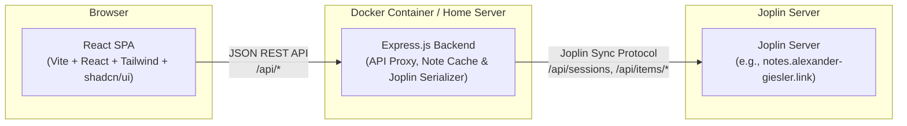

# Joplin Web — Project Plan & Architecture

A polished React web application for browsing, viewing, and managing notes on a self-hosted Joplin Server.

---

## 1. Architecture Overview

Joplin Server acts as a synchronization target (raw sync protocol with internal serialization) rather than offering a consumer-facing CRUD REST API. To bridge this, Joplin Web utilizes an Express.js backend proxy:



---

## 2. Tech Stack

| Layer | Technologies |
|---|---|
| **Frontend** | React 18, TypeScript, Vite, React Router v6 |
| **Styling & UI** | Tailwind CSS v3/v4, shadcn/ui, Lucide Icons |
| **State & Cache** | TanStack Query (React Query) v5 |
| **Markdown** | `react-markdown`, `remark-gfm`, `rehype-raw`, `rehype-highlight` |
| **Backend** | Node.js (v20+), Express.js, TypeScript (ES Modules), Axios |
| **Packaging** | Multi-stage Docker build (`node:20-alpine`), Docker Compose |

---

## 3. Joplin Server Protocol & Serializer Mechanics

### Item Naming Conventions
- Notes: `<32hexid>.md`
- Notebooks (Folders): `<32hexid>.md`
- Tags: `<32hexid>.md`
- Note-Tag Links: `<32hexid>.md`
- Resources (Metadata): `<32hexid>.md`
- Resources (Binaries): `root:/.resource/<32hexid>:/content`

### Item Types (`type_`)
- `1` = Note
- `2` = Notebook / Folder
- `4` = Resource / File attachment
- `5` = Tag
- `6` = Note-Tag association link

### Serialized Joplin Format (Bottom-Up Parsing)
Joplin serializes note objects into plain text with properties placed at the bottom:
```text
Title Line

Body content in Markdown...
Supports code blocks, tables, images, etc.

id: b1c2d3e4f5a6b7c8d9e0f1a2b3c4d5e6
parent_id: a1b2c3d4e5f6a7b8c9d0e1f2a3b4c5d6
created_time: 2026-10-17T16:00:00.000Z
updated_time: 2026-10-17T16:00:00.000Z
deleted_time: 0
is_todo: 0
type_: 1
```

- Properties are read from the **bottom up** until the first blank line.
- The remaining content above the blank line is split: line 1 = Title, remaining lines = Markdown Body.
- Internal image references in notes use the Joplin syntax ``, which the frontend transforms into `/api/resources/:id`.

---

## 4. Phase 1 — Read-Only Viewer (Completed)

### Features Implemented
- [x] **Authentication Screen**: Secure login with email and password against Joplin Server (`POST /api/sessions`), session caching, and 401 handling.
- [x] **Nested Notebooks Tree**: Recursive folder hierarchy with expand/collapse states, folder icons, and direct note count badges.
- [x] **Note List Panel**: Sort by updated time, truncated 150-char plain text previews, relative timestamps ("2 hours ago", "yesterday"), and todo status badges.
- [x] **Polished Dark Mode Theme**: Deep navy background (`#070b14`), electric violet accent (`#6366f1`), subtle translucent borders, custom scrollbars, and persistent theme switching.
- [x] **Rich Markdown Rendering**:
  - GitHub Flavored Markdown (tables, task checklists, strikethrough).
  - Syntax highlighting for code blocks with one-click copy.
  - Inline image resolution through backend proxy (`/api/resources/:id`).
- [x] **Full-Text Search**: Instant search across titles and note bodies with match relevance scoring and contextual snippets.
- [x] **Tags System**: Tag sidebar listing with accurate note counts and filtering.
- [x] **Trashcan & Soft-Deletion Support**:
  - Segregates soft-deleted notes (`deleted_time > 0`) or notes within deleted notebooks.
  - Dedicated **Trash** section in the sidebar.
  - Warning banner on deleted notes and exclusion from active notebook counts and search.
- [x] **Docker Deployment**: Complete multi-stage `Dockerfile` and `docker-compose.yml`.

---

## 5. REST API Specification (Backend -> Frontend)

| Method | Endpoint | Description |
|---|---|---|
| `POST` | `/api/auth/login` | Authenticate with Joplin credentials; returns session ID |
| `POST` | `/api/auth/logout` | Invalidate session and wipe local cache |
| `GET` | `/api/auth/check` | Validate current session token |
| `GET` | `/api/notebooks` | Get hierarchical active notebook tree with note counts |
| `GET` | `/api/notes` | List notes (supports `notebook_id`, `tag_id`, and `is_trash=true`) |
| `GET` | `/api/notes/:id` | Retrieve full note with Markdown body, tags, and notebook info |
| `GET` | `/api/tags` | List all tags with active note counts |
| `GET` | `/api/search?q=query` | Full-text search across note titles and content |
| `GET` | `/api/resources/:id` | Proxy binary resource files (images/attachments) with caching |
| `GET` | `/api/health` | Service health check |

---

## 6. Project Structure

```
joplin-web/
├── docker/
│   └── Dockerfile              # Production multi-stage build (Alpine)
├── docker-compose.yml          # Container configuration for home servers
├── .env.example                # Sample environment variables
├── PROJECT_PLAN.md             # This document
├── README.md                   # Setup and usage guide
├── LICENSE                     # MIT License
├── server/                     # Express.js REST API Backend
│   ├── package.json
│   ├── tsconfig.json
│   ├── src/
│       ├── index.ts            # Server entry point & static asset serving
│       ├── config.ts           # Environment settings
│       ├── types/
│       │   └── index.ts        # Joplin and API TypeScript definitions
│       ├── middleware/
│       │   ├── auth.ts         # Session token verification
│       │   └── error-handler.ts# Centralized error handler
│       ├── services/
│       │   ├── joplin-api.ts   # Joplin Server HTTP client
│       │   ├── serializer.ts   # Joplin sync format parser & serializer
│       │   └── note-cache.ts   # In-memory cache, tree builder, search engine
│       └── routes/
│           ├── auth.ts
│           ├── notebooks.ts
│           ├── notes.ts
│           ├── tags.ts
│           ├── search.ts
│           └── resources.ts
│   └── test/
│       └── api.test.ts         # Live end-to-end integration test suite
└── client/                     # React Single Page Application
    ├── package.json
    ├── vite.config.ts
    ├── tailwind.config.js
    ├── index.html
    └── src/
        ├── main.tsx            # React DOM entry
        ├── App.tsx             # Routing & Providers
        ├── index.css           # Tailwind tokens & dark mode styling
        ├── lib/
        │   ├── api.ts          # Frontend API client
        │   ├── types.ts        # Shared TypeScript interfaces
        │   └── utils.ts        # Helper utilities (`cn`)
        ├── hooks/
        │   ├── use-auth.ts     # Auth context & hook
        │   ├── use-notebooks.ts# TanStack Query for notebooks
        │   ├── use-notes.ts    # TanStack Query for note lists & single notes
        │   ├── use-search.ts   # Debounced search hook
        │   └── use-tags.ts     # TanStack Query for tags
        ├── components/
        │   ├── ui/             # shadcn/ui components
        │   ├── auth/           # Login form
        │   ├── layout/         # AppLayout, Sidebar, Header
        │   ├── notebooks/      # Recursive NotebookTree
        │   ├── notes/          # NoteList, NoteListItem, NoteViewer
        │   ├── search/         # SearchResults view
        │   └── common/         # MarkdownRenderer, ThemeToggle, ThemeProvider
        └── pages/
            ├── LoginPage.tsx
            └── NotesPage.tsx
```

---

## 7. Phase 2 — Editing & Management (In Progress)

Work happens on the `feature/phase-2-editing` branch; `main` / tag `v1.0-readonly` stays the stable read-only version.

### 7.1 Decisions

| Topic | Decision |
|---|---|
| Editor | CodeMirror 6 Markdown editor with **Edit / Split / Preview** modes |
| Saving | Debounced autosave (~1.5 s after typing stops) + `Ctrl+S`, with a saved/saving/error indicator |
| Deleting | Delete moves to Joplin trash (`deleted_time`); Trash view offers **Restore** and **Delete permanently** |
| Conflicts | Every write sends the `updatedTime` the editor started from; the server re-reads the item from Joplin Server and answers `409` if it changed. The UI then offers *Overwrite* or *Load theirs* (your text is copied to the clipboard) |
| Extra scope | Move note to notebook, to-do toggle + creating to-dos, notebook create / rename / delete |
| Out of scope (later) | Image/attachment upload, tag editing, permanent notebook deletion, notebook restore UI |

### 7.2 Joplin write format

- Items are written with `PUT /api/items/root:/<id>.md:/content` (multipart), deleted with `DELETE /api/items/root:/<id>.md:`.
- Serialization mirrors Joplin's `BaseItem.serialize`: `title`, blank line, `body` (notes only, when non-empty), blank line, `key: value` properties. The title line is always written (even when empty) so the body is never misread as the title.
- Updates start from the item's **original property set** and only change the edited fields plus `updated_time` / `user_updated_time`, so unknown fields round-trip untouched.
- New items get the full default property set Joplin desktop writes (32-hex id, `markup_language: 1`, `source: joplin-web`, ...).
- Encrypted items (`encryption_applied: 1`) are rejected for writing.
- Trashing a notebook sets `deleted_time` on the notebook, its sub-notebooks and their notes (as Joplin desktop does). Restoring a note also restores its trashed parent notebooks.
- Permanently deleting a note also deletes its note–tag links.

### 7.3 New REST endpoints

| Method | Endpoint | Purpose |
|---|---|---|
| `POST` | `/api/notes` | Create note / to-do (`title`, `body`, `parentId`, `isTodo`) |
| `PUT` | `/api/notes/:id` | Update `title`, `body`, `parentId` (move), `todoCompleted`; takes `baseUpdatedTime`, `force` |
| `DELETE` | `/api/notes/:id` | Move to trash; `?permanent=true` deletes from the server |
| `POST` | `/api/notes/:id/restore` | Restore from trash |
| `POST` | `/api/notebooks` | Create notebook (`title`, `parentId`) |
| `PUT` | `/api/notebooks/:id` | Rename / re-parent notebook |
| `DELETE` | `/api/notebooks/:id` | Move notebook (and contents) to trash; `?permanent=true` deletes an already trashed notebook with its contents (no UI yet) |

The in-memory cache is updated immediately after each write, so lists reflect changes without waiting for the TTL refresh.

### 7.4 Frontend work

1. API client + TanStack mutations that invalidate note / notebook / tag queries.
2. `NoteEditor` (CodeMirror, themed with the app's CSS tokens) with title field, mode switcher, autosave status, `Ctrl+S`.
3. Note header actions: Edit/Done, move-to-notebook picker, to-do toggle, delete; Restore / Delete permanently for trashed notes.
4. "New note" / "New to-do" buttons in the note list (created in the selected notebook, opened directly in edit mode).
5. To-do checkbox in the note list.
6. Sidebar notebook context menu: New sub-notebook, Rename, Delete; "New notebook" button.
7. Conflict dialog, confirm dialogs, unsaved-changes guard when navigating away.

### 7.5 Verification

- Serializer round-trip tests (including empty title, multi-line bodies, escaped properties).
- End-to-end check against the real Joplin Server using a clearly named `[joplin-web test]` note and notebook, deleted afterwards.

**Status (2026-10-17):** implemented on `feature/phase-2-editing`. Verified in the browser against Joplin Server: create notebook / sub-notebook, create note and to-do, autosave + forced re-sync round trip, both conflict resolutions, to-do toggle while editing, move, rename, trash + undo/restore, notebook trash, permanent note and notebook deletion. Serializer tests: `npm run test:unit` in `server/`. Not yet verified: how the Joplin desktop/mobile apps pick up these changes on their next sync.

### 7.6 Later

- **Image & File Attachments**: drag-and-drop upload in the editor, creating the resource metadata item (`type_: 4`) and uploading the binary to `root:/.resource/:id:/content`.
- Tag editing, notebook restore UI, UI for permanently deleting trashed notebooks.
