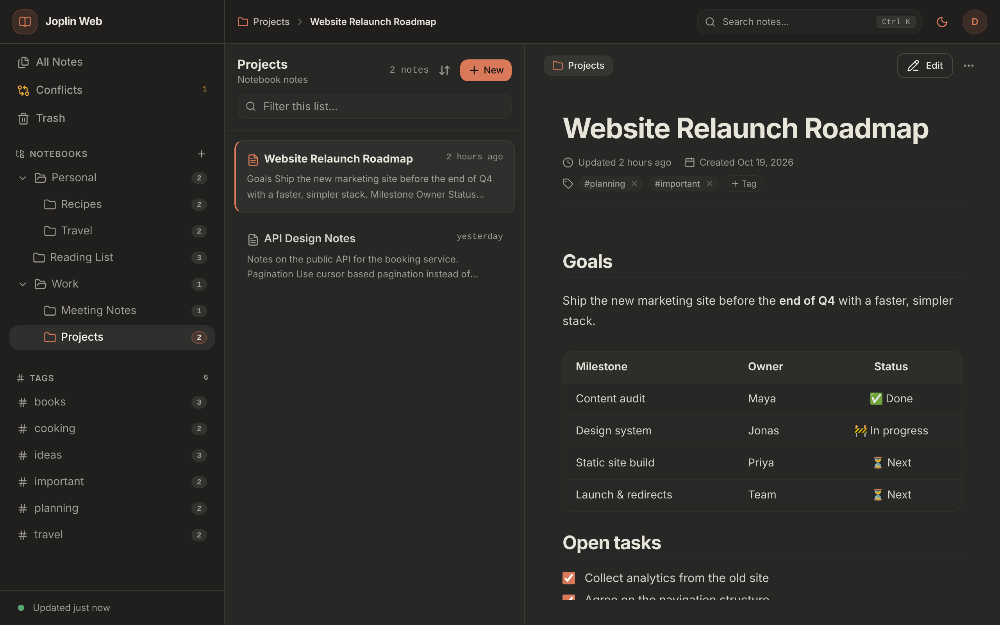
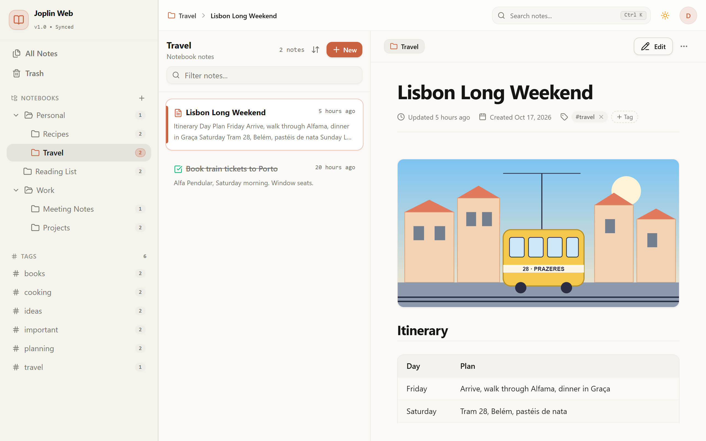
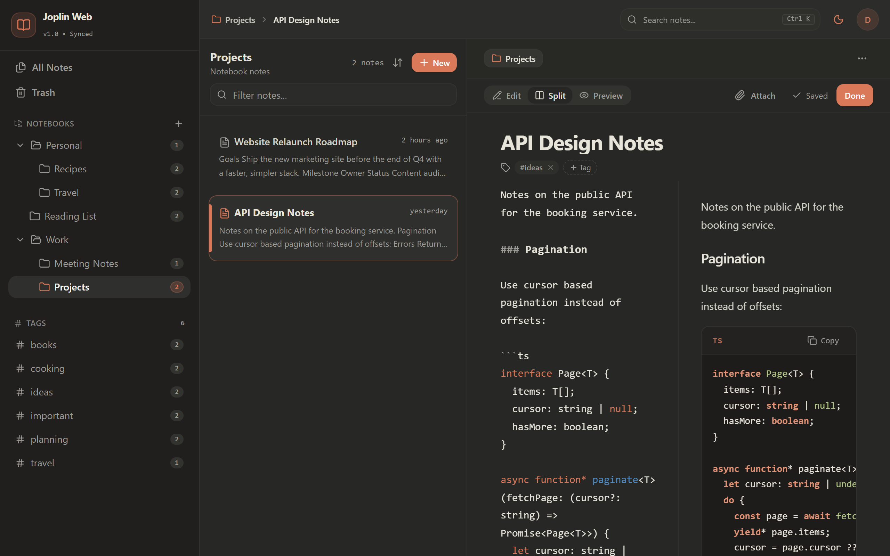
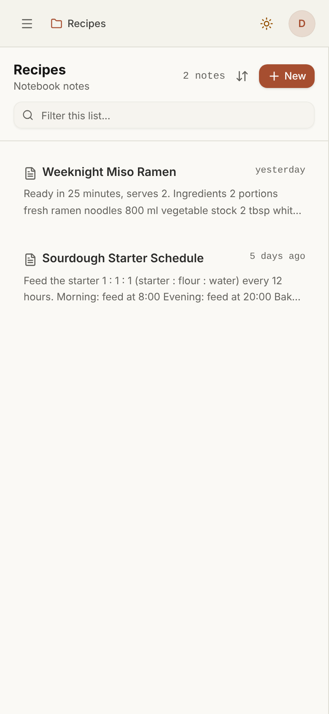
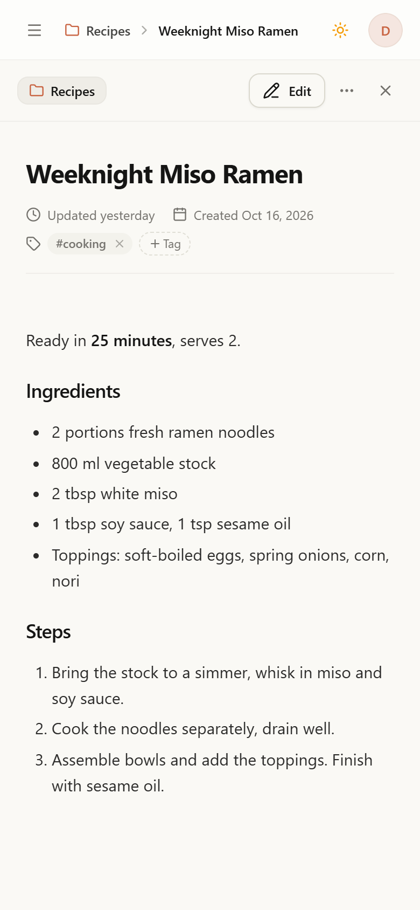
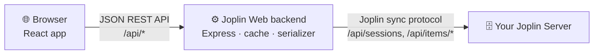

<div align="center">

# Joplin Web

**Your Joplin notes, in any browser.**

A fast, modern web client for your self-hosted [Joplin Server](https://joplinapp.org/help/apps/sync/joplin_server/).<br>
Read, write and organize your notes from any device, with nothing to install.

[](https://github.com/KamiNeko/joplin-web/actions/workflows/ci.yml)
[](LICENSE)



</div>

## Why Joplin Web?

You already run Joplin Server to sync your notes. Joplin's desktop and mobile apps work well, but sometimes you are on a work laptop, a borrowed computer or a tablet where you can't (or don't want to) install anything. **Joplin Web gives you your notes in a browser tab.** It talks directly to your Joplin Server, so your notes never leave your own infrastructure.

- 🏠 **Self-hosted, all the way.** One small Docker container next to your Joplin Server. No database, no third-party services.
- 🔄 **Stays in sync.** Changes are written in Joplin's own sync format, so they show up in your desktop and mobile apps.
- 🔐 **Uses your Joplin account.** Sign in with your Joplin Server email and password. Nothing is stored on the web server.

## Features

| | |
| :--- | :--- |
| 📚 **Notebooks** | Browse nested notebooks; create, rename, move and delete them. |
| 📝 **Markdown editor** | CodeMirror editor with *Edit*, *Split* and *Preview* modes, autosave and `Ctrl+S`. |
| ✨ **Rich rendering** | GitHub-flavored Markdown: tables, task lists, syntax-highlighted code blocks. |
| 🖼️ **Images & attachments** | Shows Joplin resources inline. Drop, paste or attach files to upload them. |
| ✅ **To-dos** | Create to-dos and tick them off, right from the note list. |
| 🏷️ **Tags** | Tag notes, browse by tag, rename and delete tags. |
| 🔎 **Search** | Instant full-text search across titles and content (`Ctrl+K`). |
| 🗑️ **Trash** | Deleted notes go to Joplin's trash and can be restored. |
| ⚔️ **Conflict detection** | If a note was changed elsewhere while you edited it, you choose which version to keep. |
| 🌗 **Light & dark mode** | Switch themes with one click. |
| 📱 **Responsive** | Works on phones and tablets as well as on the desktop. |

## Screenshots

<table>
  <tr>
    <td colspan="2"></td>
  </tr>
  <tr>
    <td colspan="2" align="center"><em>Light mode, with images stored as Joplin resources</em></td>
  </tr>
  <tr>
    <td colspan="2"></td>
  </tr>
  <tr>
    <td colspan="2" align="center"><em>Split-view editor with live preview</em></td>
  </tr>
  <tr>
    <td align="center"></td>
    <td align="center"></td>
  </tr>
  <tr>
    <td colspan="2" align="center"><em>On a phone</em></td>
  </tr>
</table>

## Getting started

You need a running **Joplin Server** and **Docker** with Docker Compose.

```bash
git clone https://github.com/KamiNeko/joplin-web.git
cd joplin-web
cp .env.example .env    # then set JOPLIN_SERVER_URL in .env
docker compose up -d --build
```

Open `http://localhost:3001` (or the `HOST_PORT` you set) and sign in with your Joplin Server account.

> [!IMPORTANT]
> Your Joplin password passes through Joplin Web on its way to your Joplin Server. Put Joplin Web behind a reverse proxy with **HTTPS** (Caddy, Traefik, nginx, …) before you use it outside your home network.

<details>
<summary>Without Docker Compose</summary>

```bash
docker build -t joplin-web -f docker/Dockerfile .
docker run -d --name joplin-web -p 3001:3001 \
  -e JOPLIN_SERVER_URL=https://notes.example.com \
  --restart unless-stopped joplin-web
```

To publish on another host port, change only the left side of the mapping, e.g. `-p 8080:3001`.

</details>

### Configuration

Docker Compose passes every variable in `.env` to the container. [`.env.example`](.env.example) lists them all.

| Variable | Default | Description |
| :--- | :--- | :--- |
| `JOPLIN_SERVER_URL` | *(required)* | Base URL of your Joplin Server, e.g. `https://notes.example.com`. Joplin Web refuses to start without it. |
| `HOST_PORT` | `3001` | Docker Compose only: the port published on the host. The container itself always listens on 3001. |
| `CORS_ORIGIN` | *(none)* | Allowed origins for API calls (comma-separated). Only needed when the UI is served from another origin than the API; the single-container setup doesn't need it. Without Docker in development mode the default is `http://localhost:5173`. |
| `CACHE_TTL_MS` | `30000` | How long the note cache is used before it is re-synced with Joplin Server, in milliseconds. |
| `AUTH_CACHE_TTL_MS` | `300000` | How long a validated session is trusted before it is checked again, in milliseconds. |
| `PORT` | `3001` | Port the server listens on when run without Docker. Leave it unset for the container; use `HOST_PORT` or the `-p` mapping instead. |

### Updating and versions

Each release is tagged `vX.Y.Z` and described in [CHANGELOG.md](CHANGELOG.md) and on the [releases page](https://github.com/KamiNeko/joplin-web/releases). To update a source build, or to go back to an earlier release (replace `v1.2.3` with a real release):

```bash
git fetch --tags
git checkout v1.2.3          # the release you want; `git checkout main` follows the latest code
docker compose up -d --build
```

Tagged releases are also published as multi-arch images (amd64, arm64) at `ghcr.io/kamineko/joplin-web`. To use one, replace `build:` in `docker-compose.yml` with `image: ghcr.io/kamineko/joplin-web:1.2.3`, then run `docker compose pull && docker compose up -d`. Pin an exact version so that you choose when to update, and roll back by setting the previous version again.

To see which version is running, open `http://localhost:3001/api/health`. It returns the version and commit (and nothing about your configuration). Please include them in bug reports.

### Try it without a Joplin Server

Want to look around first? The demo mode starts a built-in mock Joplin Server with sample notes. It needs Node.js 22+ (see [`.nvmrc`](.nvmrc)):

```bash
npm --prefix server install && npm --prefix client install
npm --prefix server run demo     # terminal 1
npm --prefix client run dev      # terminal 2
```

Open `http://localhost:5173` and sign in with `demo@joplin-web.test` / `demo`. Everything stays in memory and disappears when you stop the demo.

### Current limitations

- **End-to-end encrypted (E2EE) notes are not supported.** Encrypted items can't be read or edited.
- Joplin Web is built and tested against self-hosted Joplin Server. Joplin Cloud is untested.
- Note history (revisions) and plugins are not available.
- Prebuilt images are published from the first `vX.Y.Z` release on. Until then, build from source as shown above.

## How it works

Joplin Server is a *sync target*. It stores your notes as raw files in Joplin's own text format, and it has no regular REST API for notes. Joplin Web adds a small backend that speaks this sync protocol for you:



1. **Sign-in.** The backend opens a session on your Joplin Server with your credentials and returns the session token to the browser. Passwords are never stored.
2. **Reading.** The backend lists all items on Joplin Server, parses notes, notebooks, tags and attachments, and keeps them in a short-lived in-memory cache per session. Only changed items are fetched again.
3. **Writing.** Edits are serialized back into Joplin's format, keeping every property Joplin desktop expects, and uploaded. Your other Joplin apps pick them up on their next sync.

The production build is a single container: the backend serves the compiled React app and the API on the same port. More detail is in [docs/architecture.md](docs/architecture.md).

## Contributing

Contributions are welcome: bug reports, ideas and pull requests.

**Tech stack:** React 18, TypeScript, Vite, Tailwind CSS, shadcn/ui, TanStack Query and CodeMirror 6 on the frontend; Node.js 24, Express and TypeScript on the backend.

```text
client/   React single-page app (Vite)
server/   Express backend: auth, cache, Joplin serializer, REST API
  demo/   Mock Joplin Server + sample notes (demo mode & tests)
  test/   Serializer and API tests (Node test runner)
docker/   Production Dockerfile
docs/     Architecture notes and screenshots
```

### Development setup

```bash
cp server/.env.example server/.env       # point JOPLIN_SERVER_URL at a test server
npm --prefix server install && npm --prefix server run dev   # API on :3001
npm --prefix client install && npm --prefix client run dev   # UI on :5173
```

No test server at hand? Use `npm --prefix server run demo` instead of `run dev`.

### Before opening a pull request

```bash
npm --prefix server run typecheck && npm --prefix server test
npm --prefix client run lint && npm --prefix client run build
```

CI runs the same checks and also builds the Docker image. If your change affects the UI, refresh the screenshots with `npm --prefix client run screenshots` while the demo is running.

**Never run tests or experiments against a Joplin Server that holds real notes.** The demo server exists so you don't have to.

### Working with AI assistants

The repository ships with context for [Claude Code](https://claude.com/claude-code): [`CLAUDE.md`](CLAUDE.md) describes the architecture and conventions, and [`.claude/agents/`](.claude/agents) has specialized agents for testing, documentation, refactoring, reviews, UI/UX, security, deployment and the Joplin sync protocol.

## License

[MIT](LICENSE)
