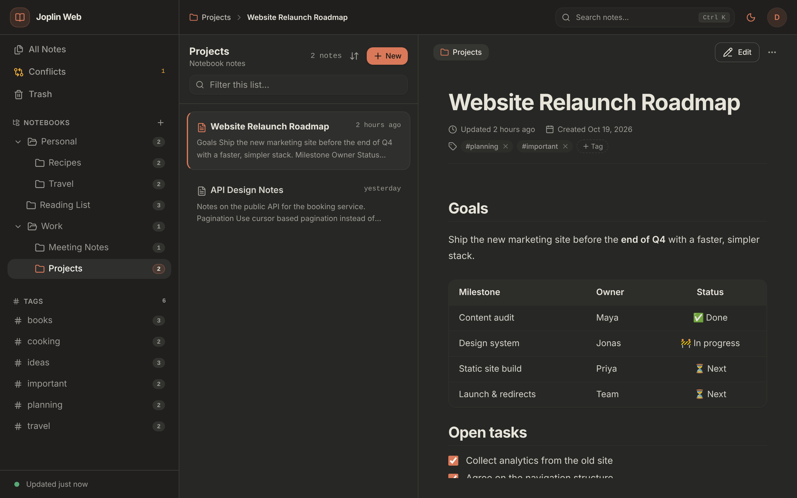
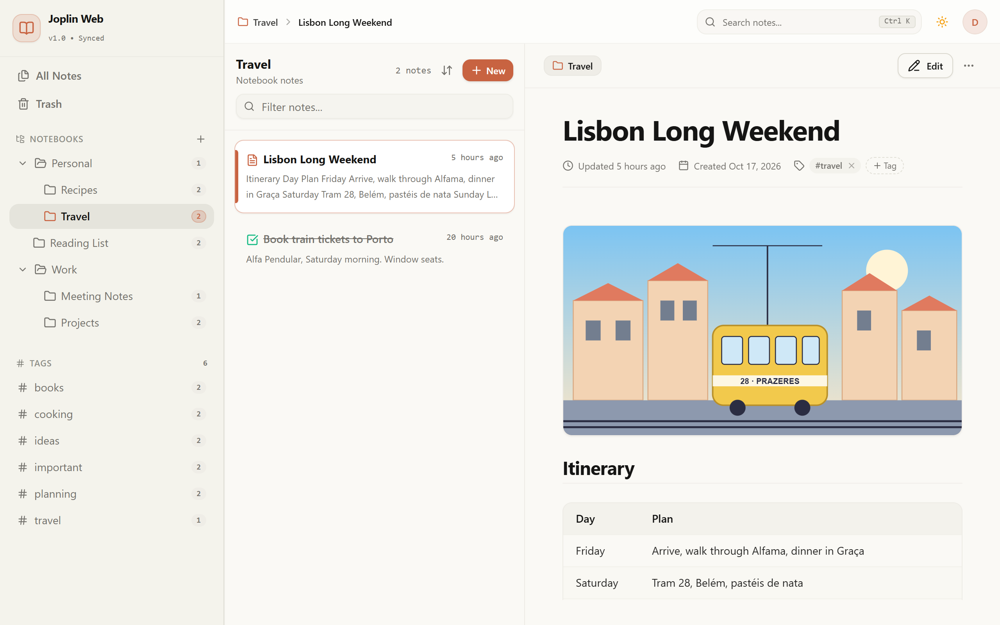
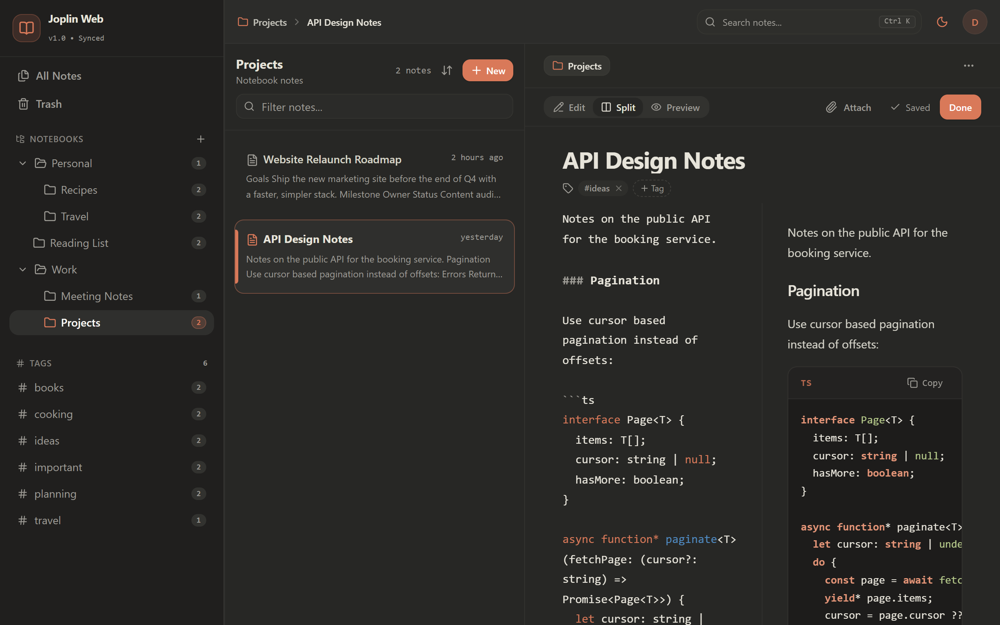
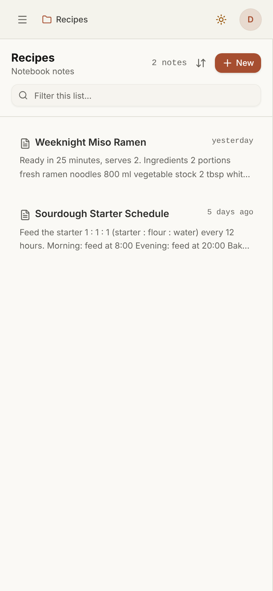
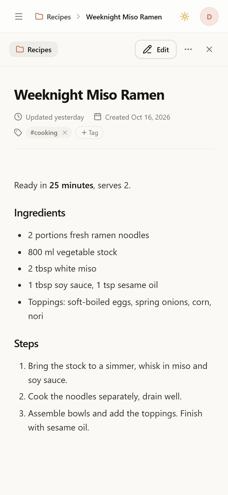
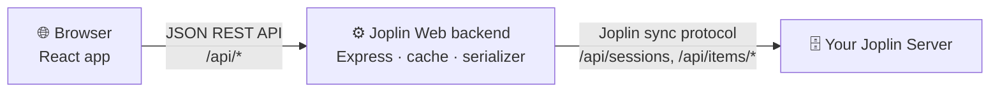

<div align="center">

# Joplin Web

**Your Joplin notes, in any browser.**

A fast, modern web client for your self-hosted [Joplin Server](https://joplinapp.org).<br>
Read, write and organize your notes from any device, with nothing to install.

[](https://github.com/KamiNeko/joplin-web/actions/workflows/ci.yml)
[](LICENSE)
[](https://github.com/KamiNeko/joplin-web/releases)
[](https://github.com/KamiNeko/joplin-web/pkgs/container/joplin-web)
[](https://github.com/KamiNeko/joplin-web/commits/main)
<br>
[](https://nodejs.org)
[](https://www.typescriptlang.org)
[](https://react.dev)
[](https://vite.dev)
[](https://expressjs.com)
[](client/e2e)



</div>

## Why Joplin Web?

You already run Joplin Server to sync your notes. Joplin's desktop and mobile apps work well, but sometimes you are on a work laptop, a borrowed computer or a tablet where you can't (or don't want to) install anything. **Joplin Web gives you your notes in a browser tab.** It talks directly to your Joplin Server, so your notes never leave your own infrastructure.

- 🏠 **Self-hosted, all the way.** One small Docker container next to your Joplin Server. No database, no third-party services.
- 🔄 **Stays in sync.** Changes are written in Joplin's own sync format, so they show up in your desktop and mobile apps.
- 🔐 **Uses your Joplin account.** Sign in with your Joplin Server email and password. Notes stay on your Joplin Server (when `CACHE_DIR` is configured, only derived caches, optional 2FA settings, workspace shortcuts/recent reads/scratchpad, and Auto-organize jobs are stored locally).

Edits made in Joplin Web have been checked to show up correctly in the Joplin apps for Windows and Android.

### How is this different from Joplin's official web app?

A web interface for Joplin is nothing new: Joplin also offers an official web app. It works like the desktop and mobile apps: it **syncs your whole notebook into the browser's storage** and works on that local copy. Joplin Web takes a fundamentally different approach: **there is no local sync.** The browser shows what the backend reads live from your Joplin Server, and every change is written straight back.

| | Joplin Web | Official web app |
| :--- | :--- | :--- |
| **Where notes live** | On your Joplin Server only; the browser keeps nothing but unsaved drafts | A full copy in the browser's storage |
| **First start** | Immediate, no initial sync | Must download and index all notes first |
| **Browsers** | Any current browser, including phones and tablets | Needs browser storage features that not every browser supports |
| **Shared or borrowed computers** | Nothing to clean up after signing out | Leaves a copy of your notes in that browser |
| **Offline use** | No: needs a connection to your server (unsaved typing is kept until it returns) | Yes, works offline and syncs later |
| **End-to-end encryption** | Not supported | Supported |

In short: choose Joplin Web if you want quick, install-free access to your notes from any browser and don't need offline mode or E2EE. If you need to work offline or use encryption, the official app is the better fit.

## Features

| | |
| :--- | :--- |
| 🏠 **Home, Shortcuts & Recent** | Workspace dashboard (`/home`) with persistent Scratchpad (*Promote to Note*) and Quick Capture to Inbox; pin favorite notes, notebooks, and saved searches in the sidebar; browse *Recently Read* and *Recently Created* notes (`/recent`). |
| ⌨️ **Command Palette** | Instant `Ctrl+P` palette to jump to shortcuts, recent notes, search hits, notebooks, tags, workspace views, or *Ask My Notes*. |
| 📚 **Notebooks** | Browse nested notebooks with clickable ancestor breadcrumbs; create, rename, move (into another notebook or to the top level), pin as shortcuts, and delete them. |
| 🗂️ **Collection Views & Bulk Actions** | Switch note lists between *List*, *Gallery* (card thumbnails), *Table* (sortable metadata), and *Board* (grouped by *Status*: *Open To-dos* / *Completed* / *Notes*, or grouped by *Tags*). Multi-select notes (`Shift`-range, `Ctrl/Cmd`-click, or *Select all*) to bulk move, tag, or trash with one-click *Undo*. |
| 🧹 **Hygiene Triage** | Local inspector (`/hygiene`) identifying exact-title & near-duplicate note clusters, empty/untitled notes, and untagged notes for bulk cleanup or *Auto-organize* without calling an LLM. |
| ✨ **AI Workspace (Auto-organize, Ask My Notes & Note Assist)** | Optional OpenAI-compatible AI (`AI_BASE_URL` + `AI_MODEL`) powering: **Auto-organize** (`/organize`, OCR + TF-IDF classification into titles, notebooks, and tags with retry & undo), **Ask My Notes** (notebook/tag-scoped Q&A returning grounded answers with clickable `:/noteId` citations), and **Note Assist** (one-click *Summarize*, *Action items*, *Suggest tags*, and *Clean up* on any open note). |
| 📝 **Markdown & Rich WYSIWYG Editor** | Switch Markdown and HTML notes between *Edit*, *Split*, *Preview*, and TipTap-powered **Rich** WYSIWYG mode (`joplin-editor-mode`), with click-to-edit prose entry, autosave, `Ctrl+S`, formatting toolbar (`Ctrl+B/I/E/K`), `/` slash commands, `[[` wiki-links, `NoteLinkPicker`, and *Copy Markdown link*. |
| ✨ **Rich Rendering, Outline, Backlinks & Properties** | GFM tables & interactive task lists, KaTeX math, Mermaid diagrams, `==highlight==`, `++insert++`, `~sub~`, `^sup^`, GitHub-style `> [!NOTE]`/`[!TIP]`/`[!WARNING]`/`[!CAUTION]` callouts, and `<details>` toggles. Inspect any note's *Document outline*, automatic *Backlinks*, and collapsible *Properties* drawer (word/reading stats, `source_url`, `author`). |
| 🖼️ **Images, Lightbox, Media, Voice & OCR** | Inline images with click-to-zoom lightbox, inline `<audio>`/`<video>` players, embedded PDFs with page-1 thumbnails, *Voice Note* microphone recording modal (with optional `AI_TRANSCRIBE_MODEL` transcription), and the *Attachments & OCR Inspector* drawer showing metadata and extracted OCR text (with optional instant upload OCR via `OCR_SERVICE_URL`). Note lists show thumbnails for the first image or PDF. |
| ✅ **To-dos & Global Tasks Hub** | Manage to-dos with due dates/alarms, plus browse a unified **Tasks Hub** (`/tasks`) across all to-do notes and inline GFM `- [ ]` checklists with conflict-safe one-click toggling. |
| 🌐 **Web Clipper & Email Ingest** | Convert article URLs to clean Markdown (`/clip` via Readability + Turndown, SSRF-guarded), use the one-click browser bookmarklet or installable PWA share target, import `.eml` / RFC-822 emails manually, or enable the headless webhook `POST /api/webhooks/email`. |
| 🏷️ **Tags** | Tag notes, browse by tag, rename and delete tags. |
| 🔎 **Search** | Instant search across titles, bodies, and attachment OCR text (`Ctrl+K`): `"exact phrases"`, `-word`, `tag:`, `-tag:`, `tag:none`, `notebook:`, `-notebook:`, `type:todo\|note`, `iscompleted:0\|1`, `has:attachment`, `has:ocr`, `sourceurl:`, `created:`, and `updated:` (`today`, `7d`, `week`, `month`, `YYYY-MM`, `>=YYYY-MM-DD`). |
| 📜 **Version History & Diffs** | Browse Joplin's revision history (`type_: 13`) in the *Version History* drawer, inspect line diffs against the current note, and restore previous versions safely. |
| 🗑️ **Trash** | Deleted notes and notebooks go to Joplin's trash, where you can restore them or delete them permanently. |
| ⚔️ **Conflict detection** | If a note was changed elsewhere while you edited it, you choose which version to keep. |
| 🔀 **Sync conflicts** | Conflict copies that Joplin desktop or mobile keep after a sync conflict are listed under *Conflicts* (only when there are any), not as duplicates in your notebooks, tags or search. Compare a copy with the original, then trash it or move it to a notebook to keep it. |
| 🔄 **Refresh & connection status** | Changes from other devices load when you return to the tab or click *Refresh*. The sidebar shows whether the server is reachable and when data was last updated. |
| 🛟 **No lost typing** | Unsaved text is kept on the device while offline or after the session expires, saves retry when the connection returns, and you can restore a draft later. |
| 🔐 **Two-factor authentication** | Optional WebAuthn passkeys and authenticator apps (TOTP), single-use recovery codes, and 30-day trusted devices (with optional `REQUIRE_2FA` enforcement). |
| 🌗 **Light & dark mode** | Switch themes with one click. |
| 📱 **Responsive** | Works on phones and tablets as well as on the desktop. |

## Screenshots

<table>
  <tr>
    <td colspan="2"></td>
  </tr>
  <tr>
    <td colspan="2" align="center"><em>Light mode, with images stored as Joplin resources</em></td>
  </tr>
  <tr>
    <td colspan="2"></td>
  </tr>
  <tr>
    <td colspan="2" align="center"><em>Split-view editor with live preview</em></td>
  </tr>
  <tr>
    <td align="center"></td>
    <td align="center"></td>
  </tr>
  <tr>
    <td colspan="2" align="center"><em>On a phone</em></td>
  </tr>
</table>

## Getting started

You need a running **Joplin Server** and **Docker** with Docker Compose (2.24 or newer). Prebuilt images for amd64 and arm64 are published at `ghcr.io/kamineko/joplin-web` (`1.1.1`, `1.1`, `1` and `latest`).

Create a `docker-compose.yml`:

```yaml
services:
  joplin-web:
    image: ghcr.io/kamineko/joplin-web:1.1.1
    container_name: joplin-web
    environment:
      JOPLIN_SERVER_URL: https://notes.example.com   # your Joplin Server
    ports:
      - "3001:3001"   # change only the left side to use another host port
    restart: unless-stopped
```

```bash
docker compose up -d
```

Open `http://localhost:3001` and sign in with your Joplin Server account. Add further settings from the [configuration](#configuration) table under `environment:`, or put them in a `.env` file and load it with `env_file: .env`.

> [!IMPORTANT]
> Your Joplin password passes through Joplin Web on its way to your Joplin Server. Put Joplin Web behind a reverse proxy with **HTTPS** (Caddy, Traefik, nginx, …) before you use it outside your home network. Behind a proxy, also set `PUBLIC_URL` and `TRUST_PROXY` (see below).

> [!NOTE]
> Browsers scope cookies to the host name, not the port. Over plain HTTP, every other web app on the same host name or IP address (e.g. `http://192.168.1.10:8080`) also receives Joplin Web's session cookie on its `/api/...` paths and could log it. Give Joplin Web its own host name, ideally with HTTPS: the cookie then becomes a `Secure` `__Host-` cookie that other apps can't overwrite, and Joplin Web rejects requests that carry conflicting session cookies.

<details>
<summary>Without Docker Compose</summary>

```bash
docker run -d --name joplin-web -p 3001:3001 \
  -e JOPLIN_SERVER_URL=https://notes.example.com \
  --restart unless-stopped ghcr.io/kamineko/joplin-web:1.1.1
```

To publish on another host port, change only the left side of the mapping, e.g. `-p 8080:3001`.

</details>

<details>
<summary>Build from source</summary>

```bash
git clone https://github.com/KamiNeko/joplin-web.git
cd joplin-web
cp .env.example .env    # then set JOPLIN_SERVER_URL in .env
docker compose up -d --build
```

The repository's `docker-compose.yml` reads `.env` and publishes `HOST_PORT` (default 3001).

</details>

### Configuration

Set these as environment variables of the container. The repository's `docker-compose.yml` passes every variable in `.env` to it; [`.env.example`](.env.example) lists them all.

| Variable | Default | Description |
| :--- | :--- | :--- |
| `JOPLIN_SERVER_URL` | *(required)* | Base URL of your Joplin Server, e.g. `https://notes.example.com`. Joplin Web refuses to start without it. |
| `PUBLIC_URL` | *(not set)* | Address you open Joplin Web at, e.g. `https://notes-web.example.com`. Set it behind a reverse proxy: writes from other origins are rejected (CSRF protection), and an `https://` value turns on the session cookie's `Secure` flag and the CSP's `upgrade-insecure-requests`. |
| `TRUST_PROXY` | `false` | Set when Joplin Web runs behind a reverse proxy, so rate limits and logs see the real client address: `1` (number of proxies in front), or a comma-separated list of proxy addresses/subnets (e.g. `loopback, 172.16.0.0/12`). Leave it off when Joplin Web is reachable directly, otherwise clients can fake their address. |
| `ALLOW_REMOTE_IMAGES` | `false` | Let notes load images from any `https://` URL (e.g. web clippings). Off by default because each remote image tells its host who opened the note and when. |
| `COOKIE_SECURE` | `auto` | `Secure` flag of the session cookie. `auto` sets it when the request came in over HTTPS (directly, via a trusted proxy, or with an `https://` `PUBLIC_URL`). |
| `HOST_PORT` | `3001` | Only for the repository's `docker-compose.yml`: the port published on the host. The container itself always listens on 3001. (`PORT` still works here but is deprecated.) |
| `CORS_ORIGIN` | *(none)* | Allowed origins for API calls (comma-separated). Only needed when the UI is served from another origin than the API; the single-container setup doesn't need it. Without Docker in development mode the default is `http://localhost:5173`. |
| `RATE_LIMIT_MAX` | `1000` | Requests per client address and 15 minutes to the API. Behind a reverse proxy without `TRUST_PROXY` all users count as one address; set `TRUST_PROXY` (or raise this) if several people use the instance. |
| `CACHE_TTL_MS` | `30000` | How long the note cache is used before it is re-synced with Joplin Server, in milliseconds. After that, reads still get the cached data (up to 10 × this value old) while the re-sync runs in the background. `0` re-syncs before every read. |
| `CACHE_DIR` | *(not set)* | Persistent directory for server state: the per-user note caches (a restart or a new login doesn't re-read every note), workspace preferences (shortcuts, recent reads, scratchpad) under `<CACHE_DIR>/prefs/`, Auto-organize job history under `<CACHE_DIR>/organize/`, and two-factor authentication data under `<CACHE_DIR>/auth/`. Required for 2FA and for `REQUIRE_2FA`. |
| `AUTH_CACHE_TTL_MS` | `300000` | How long a validated session is trusted before it is checked again, in milliseconds. |
| `AI_BASE_URL` | *(not set)* | Optional OpenAI-compatible Chat Completions base URL (e.g. `http://127.0.0.1:18317/v1`) for *Auto-organize*, *Ask My Notes*, and *Note Assist*. Must be set together with `AI_MODEL`; leave unset to keep AI features off. |
| `AI_API_KEY` | *(not set)* | Optional Bearer API key sent only to `AI_BASE_URL` (never returned to the browser or logged). |
| `AI_MODEL` | *(not set)* | Chat model name sent to `AI_BASE_URL` (e.g. `deepseek-flash`). |
| `AI_TRANSCRIBE_MODEL` | *(falls back to `AI_MODEL`)* | Optional multimodal audio-capable model name for *Voice Note* transcription via `AI_BASE_URL`. |
| `AI_CONCURRENCY` | `4` | Maximum concurrent classification requests per Auto-organize job. |
| `OCR_SERVICE_URL` | *(not set)* | Optional instant attachment OCR bridge URL (companion script [`deploy/joplin-ocr-bridge.py`](deploy/joplin-ocr-bridge.py)); requires `OCR_SERVICE_SECRET`. |
| `OCR_SERVICE_SECRET` | *(not set)* | Shared secret sent in `X-Ocr-Secret` to `OCR_SERVICE_URL`. |
| `OCR_INLINE_WAIT_MS` | `4000` | How long attachment uploads wait inline for `OCR_SERVICE_URL` before finishing OCR asynchronously in the background. |
| `REQUIRE_2FA` | `false` | Require every login to pass a second factor (users without one must enroll during login). Refuses to start when `true` and `CACHE_DIR` is unset. |
| `EMAIL_INGEST_WEBHOOK_SECRET` | *(not set)* | Optional shared secret enabling headless `POST /api/webhooks/email` ingestion (`X-Webhook-Secret` or `Authorization: Bearer`). |
| `EMAIL_INGEST_JOPLIN_EMAIL` | *(not set)* | Service Joplin Server account email used by `/api/webhooks/email` when webhook ingest is enabled. |
| `EMAIL_INGEST_JOPLIN_PASSWORD` | *(not set)* | Service Joplin Server account password used by `/api/webhooks/email`. |
| `EMAIL_INGEST_NOTEBOOK_ID` | *(not set)* | Optional target Joplin notebook ID for incoming webhook emails (defaults to the `Inbox` notebook or first writable notebook). |
| `PORT` | `3001` | Port the server listens on when run without Docker. Leave it unset for the container; use `HOST_PORT` or the `-p` mapping instead. |

> [!NOTE]
> **AI privacy:** No note data leaves your server unless you both configure `AI_BASE_URL` + `AI_MODEL` and explicitly invoke an AI action (*Auto-organize*, *Ask My Notes*, or *Note Assist*). Depending on the action, only the relevant note title(s), plain-text excerpt/body, attachment filenames/OCR text, and notebook/tag names for that scope are sent to `AI_BASE_URL`. Encrypted notes and end-to-end encrypted (read-only) accounts are always excluded. Review suggestions before applying.

### Two-factor authentication

When `CACHE_DIR` is set, signed-in users can open **Security** in the user account menu to enroll a **passkey** (WebAuthn), an **authenticator app** (6-digit RFC 6238 TOTP), or both, view/regenerate 10 one-time **recovery codes**, and revoke 30-day **trusted devices**. Set `REQUIRE_2FA=true` to require every account to enroll and verify a second factor on sign-in.

- **HTTPS and `PUBLIC_URL` for passkeys:** Browsers require a secure context for WebAuthn, and Joplin Web derives the WebAuthn Relying Party ID (`PUBLIC_URL` hostname) and expected origin from `PUBLIC_URL`. Set `PUBLIC_URL=https://...` in production to enable passkeys; only `http://localhost` works without `PUBLIC_URL` (for local development and demo mode). Authenticator apps (TOTP) work with or without `PUBLIC_URL`.
- **Passkeys (`userVerification: 'preferred'`):** WebAuthn registration and authentication request `userVerification: 'preferred'` (without hard-requiring UV), so passkeys count as a **possession factor** paired with the account password when an authenticator or platform omits PIN/biometric verification.
- **First-enroller-wins with `REQUIRE_2FA`:** When `REQUIRE_2FA=true` is turned on for an unenrolled account, whoever first completes enrollment with the account password owns the second factor; sign in and enroll right after enabling `REQUIRE_2FA`. Enrolling a user's first factor revokes all earlier sessions and clears trusted devices.
- **Scope (Joplin Web only):** Joplin Web's 2FA protects access through Joplin Web only. Joplin Server's own login (desktop/mobile sync and Joplin Server's admin/web endpoints) is not covered by Joplin Web's 2FA.
- **Pending logins & lockout:** Pending 2FA login states live in memory (5-minute TTL, 5 attempts); a server restart drops any unfinished pending logins, and their temporary upstream Joplin sessions expire on Joplin Server's schedule. Across logins, 5 consecutive failed second-factor checks lock second-factor verification for that user with exponential backoff (1 minute up to 60 minutes) until a valid check succeeds. Repeated wrong authenticator or recovery codes lock those two methods with growing waits (up to 60 minutes); **passkeys are never locked**, so you can always sign in with yours.
- **Docker persistence:** The container runs as `node` (uid `1000`) with a read-only app filesystem. Mount a persistent volume at e.g. `/data/cache` owned by uid `1000` and set `CACHE_DIR=/data/cache`.
- **API clients:** Non-browser clients (requests without an `Origin` header) can authenticate in a single request by including `totpCode` or `recoveryCode` in `POST /api/auth/login`.
- **Resetting a locked-out user (admin):** If a user loses both their second factors and recovery codes, delete `<CACHE_DIR>/auth/<ownerKey>.json` on the host (where `<ownerKey>` is the Joplin Server `user_id` when it matches `^[A-Za-z0-9_-]{1,128}$`, or the lowercase SHA-256 hex digest of `user_id` otherwise). On next sign-in they can access the account (or re-enroll immediately when `REQUIRE_2FA=true`).

### Updating and versions

Each release is tagged `vX.Y.Z`, published as `ghcr.io/kamineko/joplin-web:X.Y.Z` and described in [CHANGELOG.md](CHANGELOG.md) (read its upgrade notes first) and on the [releases page](https://github.com/KamiNeko/joplin-web/releases).

To update, set the new version in `image:` and run `docker compose pull && docker compose up -d`. Pin an exact version so that you choose when to update, and roll back by setting the previous version again. `latest` always points to the newest release.

For a source build, check out the release tag instead (`git fetch --tags && git checkout v1.1.1`) and run `docker compose up -d --build`.

To see which version is running, open *About Joplin Web* in the user menu, or `http://localhost:3001/api/health`. The endpoint returns the version and commit (and nothing about your configuration). Please include them in bug reports.

### Try it without a Joplin Server

Want to look around first? The demo mode starts a built-in mock Joplin Server with sample notes. It needs Node.js 22+ (see [`.nvmrc`](.nvmrc)):

```bash
npm --prefix server install && npm --prefix client install
npm --prefix server run demo     # terminal 1
npm --prefix client run dev      # terminal 2
```

Open `http://localhost:5173` and sign in with `demo@joplin-web.test` / `demo`. Everything stays in memory and disappears when you stop the demo.

### Current limitations

- **End-to-end encryption (E2EE) is not supported.** An account with E2EE enabled opens read-only, with a banner saying so: editing, new notes and notebooks, tags and uploads are not offered. Encrypted notes, notebooks and tags are listed as "Encrypted" but can't be read. To try it, start the demo with `DEMO_E2EE=1 npm --prefix server run demo`.
- Joplin Web is built and tested against self-hosted Joplin Server. Joplin Cloud is untested.
- Joplin plugins are not available.

## How it works

Joplin Server is a *sync target*. It stores your notes as raw files in Joplin's own text format, and it has no regular REST API for notes. Joplin Web adds a small backend that speaks this sync protocol for you:



1. **Sign-in.** The backend opens a session on your Joplin Server with your credentials and keeps the session token in an httpOnly cookie, out of reach of scripts. Passwords are never stored.
2. **Reading.** The backend lists all items on Joplin Server, parses notes, notebooks, tags and attachments, and keeps them in a short-lived in-memory cache per session. Only changed items are fetched again.
3. **Writing.** Edits are serialized back into Joplin's format, keeping every property Joplin desktop expects, and uploaded. Your other Joplin apps pick them up on their next sync.

The production build is a single container: the backend serves the compiled React app and the API on the same port. More detail is in [docs/architecture.md](docs/architecture.md).

## Contributing

Contributions are welcome: bug reports, ideas and pull requests.

**Tech stack:** React 19, TypeScript, Vite, Tailwind CSS, shadcn/ui, TanStack Query, CodeMirror 6 and TipTap 3 on the frontend; Node.js 24, Express, TypeScript and Readability/Turndown on the backend.

```text
client/   React single-page app (Vite)
  e2e/    End-to-end smoke tests (Playwright, against the demo)
server/   Express backend: auth, cache, Joplin serializer, REST API
  demo/   Mock Joplin Server + sample notes (demo mode & tests)
  test/   Serializer and API tests (Node test runner)
docker/   Production Dockerfile
docs/     Architecture notes and screenshots
```

### Development setup

```bash
cp server/.env.example server/.env       # point JOPLIN_SERVER_URL at a test server
npm --prefix server install && npm --prefix server run dev   # API on :3001
npm --prefix client install && npm --prefix client run dev   # UI on :5173
```

No test server at hand? Use `npm --prefix server run demo` instead of `run dev`.

### Before opening a pull request

```bash
npm --prefix server run typecheck && npm --prefix server test
npm --prefix client run lint && npm --prefix client test && npm --prefix client run build
npm --prefix client run test:e2e   # browser smoke tests against the demo (uses your installed Chrome)
```

CI runs the same checks and also builds the Docker image. If your change affects the UI, refresh the screenshots with `npm --prefix client run screenshots` while the demo is running.

**Never run tests or experiments against a Joplin Server that holds real notes.** The demo server exists so you don't have to.

### Working with AI assistants

The repository ships with context for [Claude Code](https://claude.com/claude-code): [`CLAUDE.md`](CLAUDE.md) describes the architecture and conventions, and [`.claude/agents/`](.claude/agents) has specialized agents for testing, documentation, refactoring, reviews, UI/UX, security, deployment and the Joplin sync protocol.

## License

[MIT](LICENSE)
