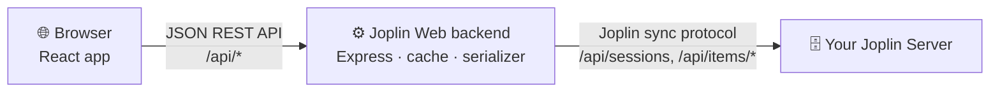

<div align="center">

# Joplin Web

**Your Joplin notes, in any browser.**

A fast, modern web client for your self-hosted [Joplin Server](https://joplinapp.org).<br>
Read, write and organize your notes from any device, with nothing to install.

[](https://github.com/KamiNeko/joplin-web/actions/workflows/ci.yml)
[](LICENSE)


</div>

## Why Joplin Web?

You already run Joplin Server to sync your notes. Joplin's desktop and mobile apps work well, but sometimes you are on a work laptop, a borrowed computer or a tablet where you can't (or don't want to) install anything. **Joplin Web gives you your notes in a browser tab.** It talks directly to your Joplin Server, so your notes never leave your own infrastructure.

- 🏠 **Self-hosted, all the way.** One small Docker container next to your Joplin Server. No database, no third-party services.
- 🔄 **Stays in sync.** Changes are written in Joplin's own sync format, so they show up in your desktop and mobile apps.
- 🔐 **Uses your Joplin account.** Sign in with your Joplin Server email and password. Nothing is stored on the web server.

Edits made in Joplin Web have been checked to show up correctly in the Joplin apps for Windows and Android.

### How is this different from Joplin's official web app?

A web interface for Joplin is nothing new: Joplin also offers an official web app. It works like the desktop and mobile apps: it **syncs your whole notebook into the browser's storage** and works on that local copy. Joplin Web takes a fundamentally different approach: **there is no local sync.** The browser shows what the backend reads live from your Joplin Server, and every change is written straight back.

| | Joplin Web | Official web app |
| :--- | :--- | :--- |
| **Where notes live** | On your Joplin Server only; the browser keeps nothing but unsaved drafts | A full copy in the browser's storage |
| **First start** | Immediate, no initial sync | Must download and index all notes first |
| **Browsers** | Any current browser, including phones and tablets | Needs browser storage features that not every browser supports |
| **Shared or borrowed computers** | Nothing to clean up after signing out | Leaves a copy of your notes in that browser |
| **Offline use** | No: needs a connection to your server (unsaved typing is kept until it returns) | Yes, works offline and syncs later |
| **End-to-end encryption** | Not supported | Supported |

In short: choose Joplin Web if you want quick, install-free access to your notes from any browser and don't need offline mode or E2EE. If you need to work offline or use encryption, the official app is the better fit.

## Features

| | |
| :--- | :--- |
| 📚 **Notebooks** | Browse nested notebooks; create, rename, move (into another notebook or to the top level) and delete them. |
| 📝 **Markdown editor** | CodeMirror editor with *Edit*, *Split* and *Preview* modes, autosave and `Ctrl+S`. |
| ✨ **Rich rendering** | GitHub-flavored Markdown: tables, task lists, syntax-highlighted code blocks. |
| 🖼️ **Images & attachments** | Shows Joplin resources inline. Drop, paste or attach files to upload them. |
| ✅ **To-dos** | Create to-dos and tick them off, right from the note list. |
| 🏷️ **Tags** | Tag notes, browse by tag, rename and delete tags. |
| 🔎 **Search** | Instant full-text search across titles and content (`Ctrl+K`). |
| 🗑️ **Trash** | Deleted notes and notebooks go to Joplin's trash, where you can restore them or delete them permanently. |
| ⚔️ **Conflict detection** | If a note was changed elsewhere while you edited it, you choose which version to keep. |
| 🔄 **Refresh & connection status** | Changes from other devices load when you return to the tab or click *Refresh*. The sidebar shows whether the server is reachable and when data was last updated. |
| 🛟 **No lost typing** | Unsaved text is kept on the device while offline or after the session expires, saves retry when the connection returns, and you can restore a draft later. |
| 🌗 **Light & dark mode** | Switch themes with one click. |
| 📱 **Responsive** | Works on phones and tablets as well as on the desktop. |

## Screenshots

<table>
  <tr>
    <td colspan="2"></td>
  </tr>
  <tr>
    <td colspan="2" align="center"><em>Light mode, with images stored as Joplin resources</em></td>
  </tr>
  <tr>
    <td colspan="2"></td>
  </tr>
  <tr>
    <td colspan="2" align="center"><em>Split-view editor with live preview</em></td>
  </tr>
  <tr>
    <td align="center"></td>
    <td align="center"></td>
  </tr>
  <tr>
    <td colspan="2" align="center"><em>On a phone</em></td>
  </tr>
</table>

## Getting started

You need a running **Joplin Server** and **Docker** with Docker Compose (2.24 or newer). Prebuilt images for amd64 and arm64 are published at `ghcr.io/kamineko/joplin-web` (`1.0.1`, `1.0`, `1` and `latest`).

Create a `docker-compose.yml`:

```yaml
services:
  joplin-web:
    image: ghcr.io/kamineko/joplin-web:1.0.1
    container_name: joplin-web
    environment:
      JOPLIN_SERVER_URL: https://notes.example.com   # your Joplin Server
    ports:
      - "3001:3001"   # change only the left side to use another host port
    restart: unless-stopped
```

```bash
docker compose up -d
```

Open `http://localhost:3001` and sign in with your Joplin Server account. Add further settings from the [configuration](#configuration) table under `environment:`, or put them in a `.env` file and load it with `env_file: .env`.

> [!IMPORTANT]
> Your Joplin password passes through Joplin Web on its way to your Joplin Server. Put Joplin Web behind a reverse proxy with **HTTPS** (Caddy, Traefik, nginx, …) before you use it outside your home network. Behind a proxy, also set `PUBLIC_URL` and `TRUST_PROXY` (see below).

> [!NOTE]
> Browsers scope cookies to the host name, not the port. Over plain HTTP, every other web app on the same host name or IP address (e.g. `http://192.168.1.10:8080`) also receives Joplin Web's session cookie on its `/api/...` paths and could log it. Give Joplin Web its own host name, ideally with HTTPS: the cookie then becomes a `Secure` `__Host-` cookie that other apps can't overwrite, and Joplin Web rejects requests that carry conflicting session cookies.

<details>
<summary>Without Docker Compose</summary>

```bash
docker run -d --name joplin-web -p 3001:3001 \
  -e JOPLIN_SERVER_URL=https://notes.example.com \
  --restart unless-stopped ghcr.io/kamineko/joplin-web:1.0.1
```

To publish on another host port, change only the left side of the mapping, e.g. `-p 8080:3001`.

</details>

<details>
<summary>Build from source</summary>

```bash
git clone https://github.com/KamiNeko/joplin-web.git
cd joplin-web
cp .env.example .env    # then set JOPLIN_SERVER_URL in .env
docker compose up -d --build
```

The repository's `docker-compose.yml` reads `.env` and publishes `HOST_PORT` (default 3001).

</details>

### Configuration

Set these as environment variables of the container. The repository's `docker-compose.yml` passes every variable in `.env` to it; [`.env.example`](.env.example) lists them all.

| Variable | Default | Description |
| :--- | :--- | :--- |
| `JOPLIN_SERVER_URL` | *(required)* | Base URL of your Joplin Server, e.g. `https://notes.example.com`. Joplin Web refuses to start without it. |
| `PUBLIC_URL` | *(not set)* | Address you open Joplin Web at, e.g. `https://notes-web.example.com`. Set it behind a reverse proxy: writes from other origins are rejected (CSRF protection), and an `https://` value turns on the session cookie's `Secure` flag and the CSP's `upgrade-insecure-requests`. |
| `TRUST_PROXY` | `false` | Set when Joplin Web runs behind a reverse proxy, so rate limits and logs see the real client address: `1` (number of proxies in front), or a comma-separated list of proxy addresses/subnets (e.g. `loopback, 172.16.0.0/12`). Leave it off when Joplin Web is reachable directly, otherwise clients can fake their address. |
| `ALLOW_REMOTE_IMAGES` | `false` | Let notes load images from any `https://` URL (e.g. web clippings). Off by default because each remote image tells its host who opened the note and when. |
| `COOKIE_SECURE` | `auto` | `Secure` flag of the session cookie. `auto` sets it when the request came in over HTTPS (directly, via a trusted proxy, or with an `https://` `PUBLIC_URL`). |
| `HOST_PORT` | `3001` | Only for the repository's `docker-compose.yml`: the port published on the host. The container itself always listens on 3001. (`PORT` still works here but is deprecated.) |
| `CORS_ORIGIN` | *(none)* | Allowed origins for API calls (comma-separated). Only needed when the UI is served from another origin than the API; the single-container setup doesn't need it. Without Docker in development mode the default is `http://localhost:5173`. |
| `CACHE_TTL_MS` | `30000` | How long the note cache is used before it is re-synced with Joplin Server, in milliseconds. |
| `AUTH_CACHE_TTL_MS` | `300000` | How long a validated session is trusted before it is checked again, in milliseconds. |
| `PORT` | `3001` | Port the server listens on when run without Docker. Leave it unset for the container; use `HOST_PORT` or the `-p` mapping instead. |

### Updating and versions

Each release is tagged `vX.Y.Z`, published as `ghcr.io/kamineko/joplin-web:X.Y.Z` and described in [CHANGELOG.md](CHANGELOG.md) (read its upgrade notes first) and on the [releases page](https://github.com/KamiNeko/joplin-web/releases).

To update, set the new version in `image:` and run `docker compose pull && docker compose up -d`. Pin an exact version so that you choose when to update, and roll back by setting the previous version again. `latest` always points to the newest release.

For a source build, check out the release tag instead (`git fetch --tags && git checkout v1.0.1`) and run `docker compose up -d --build`.

To see which version is running, open *About Joplin Web* in the user menu, or `http://localhost:3001/api/health`. The endpoint returns the version and commit (and nothing about your configuration). Please include them in bug reports.

### Try it without a Joplin Server

Want to look around first? The demo mode starts a built-in mock Joplin Server with sample notes. It needs Node.js 22+ (see [`.nvmrc`](.nvmrc)):

```bash
npm --prefix server install && npm --prefix client install
npm --prefix server run demo     # terminal 1
npm --prefix client run dev      # terminal 2
```

Open `http://localhost:5173` and sign in with `demo@joplin-web.test` / `demo`. Everything stays in memory and disappears when you stop the demo.

### Current limitations

- **End-to-end encryption (E2EE) is not supported.** Encrypted items can't be read, and Joplin Web refuses all changes while E2EE is enabled for the account.
- Joplin Web is built and tested against self-hosted Joplin Server. Joplin Cloud is untested.
- Note history (revisions) and plugins are not available.

## How it works

Joplin Server is a *sync target*. It stores your notes as raw files in Joplin's own text format, and it has no regular REST API for notes. Joplin Web adds a small backend that speaks this sync protocol for you:



1. **Sign-in.** The backend opens a session on your Joplin Server with your credentials and keeps the session token in an httpOnly cookie, out of reach of scripts. Passwords are never stored.
2. **Reading.** The backend lists all items on Joplin Server, parses notes, notebooks, tags and attachments, and keeps them in a short-lived in-memory cache per session. Only changed items are fetched again.
3. **Writing.** Edits are serialized back into Joplin's format, keeping every property Joplin desktop expects, and uploaded. Your other Joplin apps pick them up on their next sync.

The production build is a single container: the backend serves the compiled React app and the API on the same port. More detail is in [docs/architecture.md](docs/architecture.md).

## Contributing

Contributions are welcome: bug reports, ideas and pull requests.

**Tech stack:** React 19, TypeScript, Vite, Tailwind CSS, shadcn/ui, TanStack Query and CodeMirror 6 on the frontend; Node.js 24, Express and TypeScript on the backend.

```text
client/   React single-page app (Vite)
server/   Express backend: auth, cache, Joplin serializer, REST API
  demo/   Mock Joplin Server + sample notes (demo mode & tests)
  test/   Serializer and API tests (Node test runner)
docker/   Production Dockerfile
docs/     Architecture notes and screenshots
```

### Development setup

```bash
cp server/.env.example server/.env       # point JOPLIN_SERVER_URL at a test server
npm --prefix server install && npm --prefix server run dev   # API on :3001
npm --prefix client install && npm --prefix client run dev   # UI on :5173
```

No test server at hand? Use `npm --prefix server run demo` instead of `run dev`.

### Before opening a pull request

```bash
npm --prefix server run typecheck && npm --prefix server test
npm --prefix client run lint && npm --prefix client test && npm --prefix client run build
```

CI runs the same checks and also builds the Docker image. If your change affects the UI, refresh the screenshots with `npm --prefix client run screenshots` while the demo is running.

**Never run tests or experiments against a Joplin Server that holds real notes.** The demo server exists so you don't have to.

### Working with AI assistants

The repository ships with context for [Claude Code](https://claude.com/claude-code): [`CLAUDE.md`](CLAUDE.md) describes the architecture and conventions, and [`.claude/agents/`](.claude/agents) has specialized agents for testing, documentation, refactoring, reviews, UI/UX, security, deployment and the Joplin sync protocol.

## License

[MIT](LICENSE)
