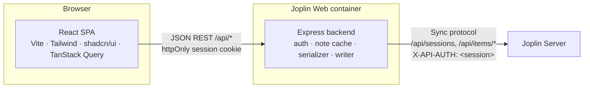
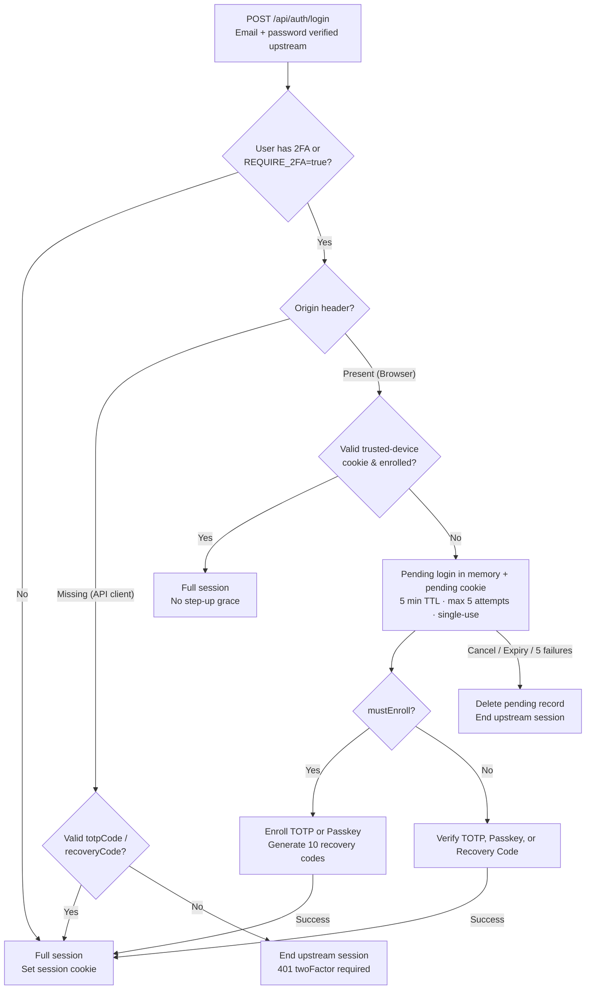

# Architecture

Joplin Server is a **sync target**: it stores raw items in Joplin's serialized text format and offers no consumer CRUD API for notes. Joplin Web puts an Express backend between the browser and Joplin Server that translates between a small JSON REST API and the sync protocol.



In production the backend also serves the compiled client (`client/dist`) on the same port. Content-hashed files under `/assets/` are sent with `Cache-Control: public, max-age=31536000, immutable`; `index.html` (also the SPA fallback) and other files with `no-cache`, so a new release is picked up on the next load.

## Backend modules (`server/src`)

| Module | Responsibility |
| :--- | :--- |
| `services/joplin-api.ts` | HTTP client for Joplin Server; maps errors to `JoplinAuthError` / `JoplinNotFoundError` / `JoplinConnectionError`. |
| `services/serializer.ts` | `deserialize` / `serialize` Joplin's text format, `stripMarkdown` / `stripHtml` (via `notePreview`, by `markup_language`) for list previews. |
| `services/note-cache.ts` | In-memory cache of all items, one per session or, with `CACHE_DIR`, one per Joplin user (shared by the user's sessions, saved to disk under format version 2 after each refresh that changed something and loaded from there after a restart; older cache versions rebuild cleanly). Refreshed after `CACHE_TTL_MS`; only changed items are re-fetched via delta or listing. Keeps `Revision` items (`type_: 13`) and each resource's `ocr_text` when `ocr_status` is `2` (detached from raw item strings so `ocr_details` is not retained). Builds the notebook tree, note lists, `notebookPath` breadcrumbs and incoming `backlinks` on `getNote`, recent read/created lists (`getRecentNotes`), tag counts (counted in one pass), unified Joplin to-dos + inline GFM checklists (`getAllTasks`), attachment/OCR inspection (`getNoteAttachments`), revision reconstruction (`getNoteRevisions`, `getNoteRevisionDetail`), local duplicate/empty/untagged hygiene reports (`getHygieneReport`), attachment OCR search, `getNoteAttachmentText(sessionId, noteId, { maxChars })`, and the conflicts list; every item carries `encrypted` (see *Encrypted items*). A session's cache is freed on logout, when Joplin Server rejects the session, and after 2 hours without use. With `CACHE_DIR` those only unlink the session (logins are mapped to users by a SHA-256 of the session id in `sessions.json`); an idle user entry leaves memory after 2 hours and is reloaded from disk. See *Cache refresh* below. |
| `services/search-query.ts` | Parses the search syntax (words, phrases, negation, `tag:`/`tag:none`/`notebook:`/`type:`/`iscompleted:`/`has:attachment`/`has:ocr`/`sourceurl:`/`created:`/`updated:` filters) and provides resource-link extraction and OCR snippet building for `note-cache`'s search; see *Search syntax*. |
| `services/note-writer.ts` | All writes: create/update/trash/restore/purge (including `sourceUrl`/`author` metadata and `restoreNoteRevision`) and bulk batch updates (shared and per-item title/notebook/`addTags`/`removeTags`) for notes, notebooks, tags, note-tag links and resources; conflict detection; `getWriteState` (the E2EE guard as a yes/no answer for the client). |
| `services/preferences-store.ts` | Per-owner workspace preferences persisted under `<CACHE_DIR>/prefs/<ownerKey>.json` (atomic temp+rename + per-owner async mutex; in-memory when `CACHE_DIR` is null): favorite notes/notebooks (shortcuts), saved searches, recently read note timestamps, and workspace scratchpad. |
| `services/inline-tasks.ts` | Pure GFM inline `- [ ]` / `- [x]` checklist extractor (`extractInlineTasks`, skipping fenced code blocks and HTML comments) and conflict-safe positional toggle (`setInlineTaskChecked`) aligned with `client/src/lib/tasks.ts`. |
| `services/revision-patch.ts` | GNU diff-match-patch unidiff parser/applier (`reconstructRevisionContent`) that walks Joplin `type_: 13` revision diffs (`title_diff`/`body_diff`) to reconstruct historical note versions. |
| `services/web-clipper.ts` | SSRF-guarded URL fetcher (`assertSafeRemoteUrl` blocking private/loopback/link-local IPs, 5-redirect cap, 5 MB limit, 15 s timeout), `@mozilla/readability` + `linkedom` + `turndown` HTML-to-Markdown extractor, and binary-safe RFC-822 / `.eml` parser (`parseEmlMessage`, preserving raw bytes/charsets, adjacent RFC 2047 words, mixed-case `boundary=` params, and `message/rfc822` parts). |
| `services/ask-ai.ts` | `AskAiService` using the optional OpenAI-compatible Chat Completions configuration for **Ask My Notes** (scores active unencrypted notes + OCR within optional notebook/tag scope and asks the LLM for cited `:/noteId` answers), **Note Assist** (`summarize`, `action-items`, `suggest-tags`, `cleanup`), and **Voice Transcription** (`/api/ai/transcribe` via multimodal `input_audio` using `AI_TRANSCRIBE_MODEL`). Includes deterministic fake outputs when `AI_FAKE=1`. |
| `services/ocr-bridge.ts` | `OcrBridgeService`: optional HTTP client (`OCR_SERVICE_URL` / `OCR_SERVICE_SECRET`, capped at 2 concurrent requests) backed on Linux hosts by `deploy/joplin-ocr-bridge.py` (`pdftotext`/`pdftoppm`/`tesseract`). Waits up to `OCR_INLINE_WAIT_MS` on image/PDF upload before returning `ocrStatus: "pending"` while continuing in the background, writes `ocr_status` (`2` done / `3` failed) and `ocr_text` via `noteWriter.updateResourceOcr`, and supports manual retries (`POST /api/resources/:id/ocr`). |
| `services/organizer.ts` | `OrganizerService`: background AI note organization via plain-`fetch` OpenAI-compatible Chat Completions (`response_format: { type: "json_object" }`, 429/5xx backoff retries, one repair retry on invalid JSON, unknown/excluded `notebookId` fallback to current notebook with `confidence = 0`). Builds a deterministic, cache-friendly system prompt per job (taxonomy paths, up to 8 non-scanner examples per notebook, existing tags, and a fixed 20-value document-type tag rule plus optional issuer/existing tag validated to at most 2 normalized lowercase-hyphenated tags; `getJob` hides issuer tags that occur in fewer than `MIN_ISSUER_TAG_NOTES` (3) of the job's suggestions, keeping type tags and tags that already exist in the account). While a job is active, holds a compact typed-array TF-IDF cosine-similarity index in memory over filed non-trashed/non-conflict/non-encrypted notes with ≥150 chars of attachment OCR (`noteCache.getAttachmentTextFromEntry`, up to 6,000 chars, excluding the job's own notes and excluded notebooks), appends up to 5 similar notes (`similarity > 0.05`) to the per-note user message only when OCR is present (keeping the system prompt byte-identical), and drops the index on finish/cancel/shutdown. Keeps multiple jobs per user newest-first (capped at `MAX_RETAINED_JOBS = 20`, dropping oldest finished jobs first) under `CACHE_DIR/organize/<ownerKey>/` (`index.json` `{ version: 2, jobs }` + per-job `<jobId>.json` `{ version: 2, job }` via atomic temp+rename writes; migrates legacy `CACHE_DIR/organize/<ownerKey>.json` v1 files with zero loss on load). Eagerly loads only running jobs and lazily loads/evicts finished jobs from disk to keep container memory small; enforces at most one running job per user (`409` with `{ runningJobId }`). Supports `retryJob` to re-queue retryable failed items (excluding skipped/duplicate-trashed items and notes that are now trashed/deleted/encrypted/conflict) while rebuilding the system prompt from the current notebook tree, resumes unfinished jobs on startup and session attach, and applies/undoes changes through `noteWriter.batchUpdateNotes`. Includes `createFakeCompletionClient` (`AI_FAKE=1`) for demo and tests. |
| `services/item-defaults.ts` | Property sets Joplin desktop writes for new notes, notebooks, tags, note-tag links and resources; used by the writer on create. |
| `services/totp.ts` | RFC 6238 TOTP generation and verification (SHA-1, 6 digits, 30 s, ±1 step window, last-accepted step replay rejection), Base32 codec, `otpauth://` URIs, and `qrcode` SVG `data:` URL rendering. |
| `services/two-factor-store.ts` | Per-user JSON storage (`CACHE_DIR/auth/<ownerKey>.json`, mode `0600`, atomic temp+rename + per-user async mutex), session 2FA binding registry (`sessions.json`) and first-factor revocation, persisted per-user failure lockout, in-memory pending logins (5 min TTL, 5-attempt cap, single-use), salted SHA-256 recovery codes, and 30-day trusted-device tokens. |
| `services/auth-cookies.ts` | Cookie builders (`joplin_web_session`, `joplin_web_2fa_pending`, `joplin_web_trusted_device` and `__Host-` variants), pending-login promotion, and safe upstream session termination. |
| `app.ts` | `createApp(config)`: helmet/CSP (including `media-src 'self' blob:`), CORS, rate limits, origin check, routers (`preferences`, `tasks`, `ai`, `clip`, `webhooks`, …), static client; triggers `organizer.resumeFromDiskOnStartup()` when enabled. `index.ts` starts the server and calls `organizer.shutdown()` on exit. Also creates the 2FA and preferences stores (sessions join the user's note cache via `onSessionRecorded`) and rate-limits `/api/auth/login` and `/api/auth/2fa`. |
| `middleware/auth.ts` | Accepts the session as `Authorization: Bearer` / `X-API-AUTH` (API clients) or the httpOnly `joplin_web_session` cookie (browser); never in the query string, which would leak into logs and referrers. Validates it against Joplin Server (cached for `AUTH_CACHE_TTL_MS`), enforces `twoFactorPassed` via `TwoFactorStore` when `CACHE_DIR` is enabled, and provides cookie readers for pending 2FA and trusted-device cookies. |
| `middleware/origin-check.ts` | CSRF protection for POST/PUT/DELETE: the `Origin` header must match the request's `Host` (or `X-Forwarded-Host` only when `TRUST_PROXY` trusts the peer), `PUBLIC_URL` or `CORS_ORIGIN`. Requests without `Origin` (non-browser clients and webhooks) pass only when they carry no auth cookies (`hasAuthCookies`, including pending and trusted-device cookies). |
| `middleware/request-logger.ts` | morgan access log with sensitive query parameters (`auth`, `token`, `password`, …) redacted. |
| `middleware/error-handler.ts` | Maps errors to JSON responses; 5xx responses carry a generic message only (details are logged). |
| `config.ts` | Reads the environment (`JOPLIN_SERVER_URL`, `PUBLIC_URL`, `CACHE_DIR`, `REQUIRE_2FA`, `TRUST_PROXY`, `ALLOW_REMOTE_IMAGES`, `COOKIE_SECURE`, `RATE_LIMIT_MAX`, `AI_*`, `AI_TRANSCRIBE_MODEL`, `OCR_SERVICE_*`, `OCR_INLINE_WAIT_MS`, `EMAIL_INGEST_*`, …); exits at startup on invalid values, missing `JOPLIN_SERVER_URL`, or `REQUIRE_2FA=true` without `CACHE_DIR`. Resolves WebAuthn RP ID/origin from `PUBLIC_URL` (or `http://localhost` outside production). |
| `routes/*.ts` | Thin Express 5 routers per resource (`auth.ts`, `two-factor.ts`, `preferences.ts`, `notes.ts`, `tasks.ts`, `organize.ts`, `ask.ts`, `clip.ts`, …). Handlers are plain `async` functions: Express 5 forwards rejected promises to the error handler, so they have no try/catch. |

## Joplin sync protocol

### Endpoints used

| Call | Purpose |
| :--- | :--- |
| `GET /api/ping` | Health check |
| `POST /api/sessions` `{ email, password }` | Login, returns `{ id, user_id }` |
| `POST /logout` (`X-API-AUTH` + `sessionId` cookie) | Ends the session (Joplin Server's web logout; there is no API route for it). Its CSRF check skips `/logout`. Success is a redirect to `<baseUrl>/login`; anything else is treated as failure. |
| `GET /api/items/root:/:/children?cursor=` | Paginated listing of all items (`{ items, has_more, cursor }`), at most 100 per page |
| `GET /api/items/root/delta?cursor=&limit=` | Changes since a cursor (`{ items: [{ item_name, type, updated_time }], cursor, has_more }`, `type` 1 created, 2 updated, 3 deleted; an empty cursor starts at the beginning). `400` with `code: "resyncRequired"` when the cursor was pruned. Used for refreshes after the first listing; a server without it (`404`) is listed in full every time. |
| `GET /api/items/root:/<id>.md:/content` | Raw item text |
| `GET /api/items/root:/.resource/<id>:/content` | Attachment binary |
| `GET /api/items/root:/info.json:/content` | Sync target info (E2EE state), checked before writes (see Write rules); 404 means none yet |
| `PUT /api/items/root:/<name>:/content` | Create or replace an item (multipart, field `file`) |
| `DELETE /api/items/root:/<name>:` | Delete an item |

### Cache refresh

The first refresh notes where the delta feed stands, then lists all items (`/children`, every page) and reads the `.md` items (10 in parallel). Later refreshes read only the changes since from the delta feed (one request when nothing changed), re-read the changed `.md` items and drop deleted ones. When the cursor has expired (`resyncRequired`) or the server has no delta feed, a refresh lists all items again, re-reads only `.md` items whose `updated_time` differs from the cached one and drops items missing from the listing. When it runs:

- **Reads** (lists, tree, tags, search, note, attachment metadata): within `CACHE_TTL_MS` the cache answers directly. Once it has expired, data up to 10 × `CACHE_TTL_MS` old is still served at once while a refresh runs in the background (stale-while-revalidate); concurrent requests share one refresh. The first load, older data, and the first read after a failed refresh wait for the refresh. With `CACHE_TTL_MS=0` every read waits.
- **Writes** (`noteCache.getEntry`) never use expired data: they wait for a refresh (or join the one running), since the E2EE check, link cleanup and tag-name lookups rely on it.
- **Forced** (`POST /api/notebooks/refresh`, notebook purge) always wait; a refresh already running is joined.
- **Errors:** a failed background refresh is logged and handled (never an unhandled rejection) and marks the entry, so the next read refreshes synchronously and its error reaches the error handler like before: an expired session is answered with `401` and marked invalid one request later; an unreachable server answers `503`. The request that started the failed refresh got the stale data.
- Background refreshes use the same "local write" guards as before (see Write rules), so a write made while one runs is not undone.

The delta API (`/api/items/root:/:/delta?cursor=`) is not used yet: it would avoid listing every item, but its change entries carry the change time rather than the item's `updated_time`, a first cursor requires walking the account's whole change history, and an expired cursor needs a full resync.

### Item types (`type_`)

`1` Note · `2` Folder (notebook) · `4` Resource (attachment metadata) · `5` Tag · `6` Note–tag link · `13` Revision. Other types (settings, alarms, …) are ignored. Every item is stored as `<32-hex-id>.md`; attachment binaries live at `.resource/<id>`.

### Serialized format

```text
Title line

Markdown body (notes only)…

id: b1c2d3e4f5a6b7c8d9e0f1a2b3c4d5e6
parent_id: a1b2c3d4e5f6a7b8c9d0e1f2a3b4c5d6
created_time: 2026-10-17T16:00:00.000Z
updated_time: 2026-10-17T16:05:00.000Z
is_todo: 0
type_: 1
```

- Properties are parsed **bottom-up** until the first blank line; line 1 above it is the title, the rest (after one blank line) is the body. Property order is kept on a round trip.
- Only the item times (`created_time`, `updated_time`, `user_*_time`) are ISO strings. `todo_due` (due date / alarm) and `todo_completed` stay Unix ms numbers, `0` when unset, as Joplin desktop writes them.
- Like Joplin's `BaseItem.unserialize`, content is split on `\n` only: a `\r` in the body (CRLF line endings) is part of the text and is written back unchanged. Only property lines are trimmed.
- Newlines in property values are escaped as `\n`, with Joplin's exact escape/unescape chain. That format cannot tell a backslash followed by a real newline from a literal `\n`; Joplin has the same limitation (#55), and matching it keeps values read identically by all clients.
- Notes reference image attachments as ``, other attachments (including PDFs) as `[name](:/<resourceId>)`, and other notes as `[text](:/<noteId>)`; the client resolves these to `/api/resources/:id` (inline images or PDF viewer, download button otherwise) and in-app links.

### Write rules

- Serialization mirrors Joplin's `BaseItem.serialize`. The title line is always written (even when empty), so a body is never read back as a title.
- Updates start from the item's **original property set** and change only the edited fields plus `updated_time` / `user_updated_time`. Unknown properties round-trip untouched.
- New items get the full default property set Joplin desktop writes (32-hex id, `markup_language: 1`, `source: joplin-web`, …).
- Ids in paths are validated against `^[0-9a-f]{32}$` before any request is made.
- **E2EE:** Joplin Web cannot encrypt. Before writing it checks `info.json`; if `e2ee.value` is true (or the file is unreadable) the write is refused with `422`, so nothing is uploaded in plaintext to an encrypted account. A successful check is reused per session for up to 60 s while the cache listing shows the same `info.json` `updated_time`, so autosaves do not re-read it; a refresh that sees a changed `info.json` forces a new check. E2EE turned on by another client therefore blocks writes after at most the shorter of the cache TTL and 60 s. Without an `info.json` (sync targets older than sync version 3), master key items (`type_: 9`), any `encryption_applied: 1` item, or an item the cache failed to read (it could be a master key) make the account read-only too. Encrypted items (`encryption_applied: 1`) are refused as well, as targets too: no notes or sub-notebooks in an encrypted notebook, no links to an encrypted tag. `GET /api/account/write-state` runs the same check (`noteWriter.getWriteState`) and answers `{ writable: false, reason }` with the exact message a write would be refused with, so the client turns read-only up front instead of failing every save; other failures (expired session, Joplin Server down) are errors as usual.
- **Encrypted items** keep only `id`, `parent_id`, `note_id`, `tag_id`, `updated_time`, `deleted_time` and `type_` in clear (Joplin's `BaseItem.serializeForSync`); title, body and everything else are in `encryption_cipher_text`. The cache never tries to read them: lists, details, the tree, the trash and tags mark them `encrypted: true`; notebooks and tags get the display titles "Encrypted notebook" / "Encrypted tag", notes keep an empty title and body (the client shows "Encrypted note"). Search never inspects cipher text or attachments of encrypted notes, and attachment OCR is only extracted from unencrypted resources.
- Target notebooks (create, move) are re-read from Joplin Server, so one trashed or deleted elsewhere is refused even while the cache still shows it. A note in the trash (or in a trashed notebook) cannot be tagged.
- **Conflicts:** writes carry the `baseUpdatedTime` the editor started from; the writer re-reads the item and answers `409` with the current version if it changed. The UI offers *Overwrite* (`force: true`) or *Load theirs*.
- **Bulk updates:** `POST /api/notes/batch` (up to `MAX_BATCH_SIZE = 1000` items per request) reuses the same E2EE check, active-notebook validation, fresh reads, conflict detection via per-item `baseUpdatedTime`, and `noteCache.upsertItem` updates as single-note writes. Writes toward Joplin Server run with bounded concurrency (`BATCH_CONCURRENCY = 4`, serialized per note id) and return per-item `{ id, status: "ok" | "conflict" | "error", updatedTime?, error?, addedTags? }`, so one conflicting or failing item never aborts the batch (`addedTags` reports only tags newly linked to that note so client undo never removes pre-existing tags).
- **Trash:** deleting sets `deleted_time`. Trashing a notebook also trashes its sub-notebooks and their notes; restoring a note restores its trashed parent notebooks. Restoring a notebook (only one in the trash, else `409`) brings back the sub-notebooks and notes trashed *together* with it, plus any trashed parent notebooks; items trashed on their own earlier stay in the trash. "Together" means a `deleted_time` at most 60 s before the notebook's (`services/trash.ts`): Joplin Web stamps a cascade with one time, but Joplin desktop trashes children first, each with its own `Date.now()`. (Joplin desktop's own restore brings back all notes of a folder and moves items with a trashed parent to the top level instead.) The trash list counts the same way, so its numbers match what Restore brings back. Cascades read every affected item first (up to 10 reads in parallel, level by level) and write only if all pass (no encrypted item), so they never stop halfway on such an item.
- **Conflict copies** (`is_conflict: 1`): when Joplin desktop/mobile hits a sync conflict it keeps a copy of the note with `is_conflict: 1` and `conflict_original_id` in the original notebook, and shows it only in its virtual *Conflicts* folder. Joplin Web mirrors `Note.previews` / `Folder.noteCountsByFolderId`: conflict copies are left out of notebook and tag lists, "All notes", note counts, tag counts and search, and listed only with `GET /api/notes?is_conflict=true` (`is_conflict = 1 AND deleted_time = 0`, wherever their notebook is). Like `Folder.batchDelete`, trashing or purging a notebook leaves its untrashed conflict copies alone (they stay in *Conflicts*, a purged notebook's copies have no notebook any more); a copy in a trashed notebook is therefore not in the trash and can only be purged after trashing it itself. Trashing a copy sets its own `deleted_time` (it keeps `is_conflict`, so restoring brings it back to *Conflicts* without touching its notebook). Editing keeps the flag; moving it to a notebook (its own one too) clears `is_conflict` and `conflict_original_id`, as `Note.moveToFolder` does, which turns it into a regular note.
- **Permanent deletion** only applies to items in the trash, like Joplin's *Delete permanently*. A note is re-read and must be a note (not a notebook, tag or resource), not encrypted, and trashed itself or inside a trashed notebook. Purging a notebook refreshes the cache and re-reads each item, so notes another client moved out are kept. Note–tag links are removed too.
- After each write the cache is updated immediately, so lists reflect the change without waiting for the TTL. Written items get a negative "local write" timestamp, so the next refresh re-reads them and removes them if another client deleted them meanwhile. A refresh that started before a local write or delete does not apply the content it fetched for that item, so a slow refresh cannot put an older version back into the cache (which would cause a false `409` on the next autosave).
- **Joplin Server errors:** a `401`, or a `403` for a session that Joplin Server no longer accepts (re-checked), answers `401` and marks the session invalid, so the client signs in again. A `403` for a valid session stays `403`. `5xx` errors answer with a generic message, never the upstream text.

## REST API (backend → browser)

All routes except `/api/health`, `/api/auth/login`, `/api/auth/logout`, the pending-2FA login/enrollment endpoints under `/api/auth/2fa/*`, and `/api/webhooks/email` (verified via `EMAIL_INGEST_WEBHOOK_SECRET`) require a full verified session (or a validated `mustEnroll` pending login where explicitly noted).

| Method | Path | Description |
| :--- | :--- | :--- |
| `GET` | `/api/health` | Health check: `{ status, version, commit }` (build metadata only, no configuration) |
| `POST` | `/api/auth/login` | `{ email, password, totpCode?, recoveryCode? }` → sets `joplin_web_session` / `__Host-joplin_web_session` (browser) or returns `{ userId, sessionId }` (API clients without `Origin`). When 2FA is active or `REQUIRE_2FA=true`, browsers without a valid trusted-device cookie receive `{ twoFactor: { required: true, methods, mustEnroll, passkeysAvailable } }` and an httpOnly pending cookie instead of a session cookie; API clients must pass `totpCode` or `recoveryCode` in the same request or receive `401`. Requests carrying duplicate session cookies get `401`. |
| `POST` | `/api/auth/logout` | Ends an active session or pending 2FA login on Joplin Server, drops cached session state and the note cache, clears session and pending cookies |
| `GET` | `/api/auth/check` | Validates the session → `{ valid: true, serverHost }` (Joplin Server host and port, for display; visible to every signed-in user) |
| `GET` | `/api/auth/2fa/status` | `{ persistenceEnabled, require2fa, passkeysAvailable, enrolled: { totp, passkeysCount, recoveryCodesRemaining }, methods, stepUpValid, stepUpExpiresAt }` |
| `POST` | `/api/auth/2fa/totp/setup` | Generates pending TOTP secret + `otpauthUri` + SVG `qrDataUrl` (`mustEnroll` pending login or step-up session; inactive until confirmed) |
| `POST` | `/api/auth/2fa/totp/confirm` | Verifies 6-digit `{ code, trustDevice? }` to enable TOTP; generates 10 recovery codes on first factor and promotes a pending login |
| `POST` | `/api/auth/2fa/totp/verify` | Verifies `{ code, trustDevice? }` against pending login and promotes it to a full session (rejects replayed step) |
| `DELETE` | `/api/auth/2fa/totp` | Removes TOTP (full session + fresh step-up; returns `400` if removing the last factor while `REQUIRE_2FA=true`) |
| `POST` | `/api/auth/2fa/passkey/register/options` | Returns `@simplewebauthn/server` registration options (`residentKey: "preferred"`, `userVerification: "preferred"`, `excludeCredentials`) |
| `POST` | `/api/auth/2fa/passkey/register/verify` | Verifies attestation response (`{ response, name?, trustDevice? }`); generates recovery codes on first factor and promotes a pending login |
| `POST` | `/api/auth/2fa/passkey/auth/options` | Returns passkey assertion options for the active pending login |
| `POST` | `/api/auth/2fa/passkey/auth/verify` | Verifies `{ response, trustDevice? }`, enforces monotonic signature counter, promotes pending login |
| `GET` | `/api/auth/2fa/passkeys` | Lists enrolled passkeys (`{ id, name, createdAt, lastUsedAt }`) |
| `PUT` | `/api/auth/2fa/passkeys/:id` | Renames a passkey (full session + step-up) |
| `DELETE` | `/api/auth/2fa/passkeys/:id` | Removes a passkey (full session + step-up; refuses last factor when `REQUIRE_2FA=true`) |
| `POST` | `/api/auth/2fa/recovery/verify` | Consumes a single-use recovery code (`{ code, trustDevice? }`) and promotes the pending login |
| `POST` | `/api/auth/2fa/recovery/regenerate` | Replaces all recovery codes with 10 fresh codes (full session + step-up) |
| `POST` | `/api/auth/2fa/step-up/totp` | Verifies TOTP `{ code }` for an active session to open a 5-minute step-up window |
| `POST` | `/api/auth/2fa/step-up/passkey/options` | Returns passkey assertion options for an active session's step-up check |
| `POST` | `/api/auth/2fa/step-up/passkey/verify` | Verifies passkey assertion for an active session to open a 5-minute step-up window |
| `POST` | `/api/auth/2fa/step-up/recovery` | Consumes a recovery code `{ code }` to open a 5-minute step-up window |
| `GET` | `/api/auth/2fa/trusted-devices` | Lists active non-expired trusted devices (`{ id, label, createdAt, lastUsedAt, expiresAt, current }`) |
| `DELETE` | `/api/auth/2fa/trusted-devices` | Revokes all trusted devices for the user and clears the trusted-device cookie (full session + step-up) |
| `DELETE` | `/api/auth/2fa/trusted-devices/:id` | Revokes one trusted device (full session + step-up; clears cookie if current) |
| `GET` | `/api/account/write-state` | `{ writable: true }`, or `{ writable: false, reason }` when the account is read-only (E2EE); same check as every write |
| `GET` | `/api/notebooks` | Nested notebook tree with note counts |
| `GET` | `/api/notebooks/trash` | Trashed notebooks (top of each trashed subtree) with note and sub-notebook counts |
| `POST` | `/api/notebooks/refresh` | Forces a cache re-sync |
| `POST` | `/api/notebooks` | Create notebook `{ title, parentId }` |
| `PUT` | `/api/notebooks/:id` | Rename / move notebook |
| `DELETE` | `/api/notebooks/:id` | Trash notebook; `?permanent=true` deletes a trashed one |
| `POST` | `/api/notebooks/:id/restore` | Restore a trashed notebook with its contents |
| `GET` | `/api/notes` | List; filters `notebook_id`, `tag_id`, `is_trash`; `is_conflict=true` lists only conflict copies (other filters ignored). Items carry `isConflict` and `tagIds`. |
| `GET` | `/api/notes/recent` | `{ recentRead, recentCreated }` mixing tracked `recentReads` from `PreferencesStore` and active notes ordered by `createdTime` (supports `?limit=1..100`, default `50`) |
| `GET` | `/api/notes/:id` | Note with body, list `preview`, notebook, `notebookPath` ancestor breadcrumbs, incoming `backlinks`, tags, `properties`, and `markupLanguage` (1 = Markdown, 2 = HTML; the write routes below return the same shape); `isConflict` / `conflictOriginalId` for conflict copies |
| `POST` | `/api/notes` | Create `{ title, body, parentId, isTodo }` |
| `PUT` | `/api/notes/:id` | Update `{ title, body, parentId, todoCompleted, todoDue, baseUpdatedTime, force }`; `todoDue` is Unix ms (`0`/`null` clears it, only to-dos can have one) |
| `POST` | `/api/notes/batch` | Bulk update `{ items: [{ id, baseUpdatedTime?, parentId?, title?, addTags?, removeTags? }], parentId?, addTags?, removeTags?, trash?, restore? }` (up to 1000 items); returns per-item `[{ id, status: "ok" \| "conflict" \| "error", updatedTime?, error?, addedTags? }]` |
| `GET` | `/api/notes/:id/attachments` | Linked attachments ordered by body appearance, with MIME type, classified `kind` (`image \| pdf \| audio \| video \| file`), live/persisted `ocrStatus` (`pending \| done \| failed`), and extracted OCR text |
| `GET` | `/api/notes/:id/revisions` | Revision metadata (`type_: 13`) for the note, newest first |
| `GET` | `/api/notes/:id/revisions/:revId` | Reconstructed `{ id, itemId, title, body, updatedTime, createdTime }` by applying revision patches along the note's diff chain |
| `POST` | `/api/notes/:id/revisions/:revId/restore` | Restores a note's title and body from `:revId` (`{ baseUpdatedTime?, force? }`) with optimistic concurrency check |
| `GET` | `/api/organize/status` | `{ enabled, model? }` whether AI features (Auto-organize, Ask My Notes, Note Assist) are configured (`AI_BASE_URL` + `AI_MODEL`); never exposes provider URLs or keys |
| `GET` | `/api/organize/hygiene` | Local hygiene inspection `{ duplicateClusters, emptyNotes, untaggedNotes }` without calling an LLM |
| `GET` | `/api/organize/jobs` | `{ jobs }` summary list of the user's retained Auto-organize jobs newest first (`id`, `status`, `progress`, `appliedCount`, `usage`, `canUndo`, `createdAt`, `updatedAt`) |
| `POST` | `/api/organize/jobs` | Start background Auto-organize job `{ noteIds, excludeNotebookIds? }` → `201 { jobId }` (`409` with `details.runningJobId` when another job is already running; `503` when disabled) |
| `GET` | `/api/organize/jobs/:id` | Progress `{ total, done, failed }`, `appliedCount`, `retryableFailedCount`, token `usage`, `canUndo`, and paged items (`?offset=&limit=`) with current note metadata & suggestions |
| `DELETE` | `/api/organize/jobs/:id` | Cancel a running Auto-organize job; `?remove=1` permanently deletes a finished/cancelled/failed job (`409` if still running) |
| `POST` | `/api/organize/jobs/:id/retry` | Re-queue retryable failed items (skipping non-retryable/trashed/conflict/encrypted notes), rebuild the system prompt from the current notebook tree, and resume the job (`409` if another job is running or nothing is retryable) |
| `POST` | `/api/organize/jobs/:id/apply` | Apply reviewed changes `{ items: [{ noteId, title?, notebookId?, addTags?, baseUpdatedTime? }] }` via `batchUpdateNotes` and store undo snapshot |
| `POST` | `/api/organize/jobs/:id/undo` | Revert the last apply for this job via `batchUpdateNotes` (skipping notes changed elsewhere since apply) |
| `DELETE` | `/api/notes/:id` | Trash; `?permanent=true` deletes |
| `POST` | `/api/notes/:id/restore` | Restore from trash |
| `POST` | `/api/notes/:id/tags` | Add tag by title `{ title }` |
| `DELETE` | `/api/notes/:id/tags/:tagId` | Remove tag from note |
| `GET` | `/api/tags` | Tags with note counts |
| `PUT` | `/api/tags/:id` | Rename tag |
| `DELETE` | `/api/tags/:id` | Delete tag and its links |
| `GET` | `/api/search?q=` | Search over active notes (see *Search syntax*); each result has `matches: { inTitle, inBody, matchedIn?, snippet, terms }` |
| `POST` | `/api/resources` | Upload attachment (raw body, `X-File-Name`, `X-File-Type`); runs inline OCR wait up to `OCR_INLINE_WAIT_MS` when `OCR_SERVICE_URL` is set (`ocrStatus`, optional `ocrText`) |
| `POST` | `/api/resources/:id/ocr` | Manually trigger (or join in-flight) OCR extraction for an image or PDF resource |
| `GET` | `/api/resources/:id` | Attachment binary (see *Serving attachments*) |
| `DELETE` | `/api/resources/:id` | Delete attachment |
| `GET` | `/api/preferences` | Returns per-owner `HydratedPreferences` (favorite notes/notebooks, saved searches, recent reads, scratchpad) |
| `POST` / `DELETE` | `/api/preferences/favorites/notes/:id` | Pin or unpin a favorite note shortcut and return updated `HydratedPreferences` |
| `POST` / `DELETE` | `/api/preferences/favorites/notebooks/:id` | Pin or unpin a favorite notebook shortcut and return updated `HydratedPreferences` |
| `POST` | `/api/preferences/saved-searches` | Save a search shortcut `{ name, query }` → `201` |
| `DELETE` | `/api/preferences/saved-searches/:id` | Remove a saved search shortcut |
| `POST` | `/api/preferences/recent-reads/:id` | Record a note read timestamp for *Recently Read* tracking |
| `PUT` | `/api/preferences/scratchpad` | Persist workspace scratchpad text `{ scratchpad }` |
| `GET` | `/api/tasks` | `{ todoNotes, inlineTasks }` combining Joplin to-do notes and interactive GFM checklist items across active notes |
| `POST` | `/api/tasks/toggle` | Conflict-checked toggle for an inline GFM checklist item `{ noteId, line, column, checked, baseUpdatedTime? }` (`409` if line moved) |
| `GET` | `/api/ai/status` | `{ enabled, model?, transcribeEnabled, transcribeModel? }` AI availability for *Ask My Notes*, *Note Assist*, and *Voice Transcription* |
| `POST` | `/api/ai/ask` | Grounded Q&A `{ question, scopeNotebookId?, scopeTagId? }` returning `{ answer, citations, usage? }` (`503` when disabled) |
| `POST` | `/api/ai/note-assist` | Single-note AI action `{ noteId, action: "summarize" \| "action-items" \| "suggest-tags" \| "cleanup" }` (`422` on encrypted notes) |
| `POST` | `/api/ai/transcribe` | Transcribe uploaded audio (raw `audio/*` / `application/octet-stream` with `X-File-Type`, or `{ audioBase64, mime }` JSON) via `AI_TRANSCRIBE_MODEL` |
| `POST` | `/api/clip` | Fetch and clip a readable web URL `{ url, parentId?, tags?, includeSourceBanner? }` → `201 { note, extractedTitle, siteName? }` (SSRF-guarded) |
| `POST` | `/api/integrations/email` | Import a note from raw RFC-822 `.eml` text or structured `{ subject, from, text, html, parentId?, tags? }` |
| `POST` | `/api/webhooks/email` | Headless incoming email webhook accepting raw `message/rfc822` (up to 25 MB, e.g. from a Cloudflare Email Worker) or JSON payloads authenticated via `X-Webhook-Secret` / `Authorization: Bearer` (`EMAIL_INGEST_WEBHOOK_SECRET`), defaulting to `Inbox` or `Pending to sort` |

### Search syntax

`GET /api/search` uses a subset of Joplin desktop's syntax, parsed by `services/search-query.ts`. Everything is case-insensitive; trashed notes (and notes in trashed notebooks) are never returned.

| Syntax | Meaning |
| :--- | :--- |
| `shopping list` | Every word must appear in the title, body, or a linked attachment's `ocr_text` (`ocr_status: 2`), in any order (substring match). |
| `"shopping list"` | Exact phrase. An unclosed quote runs to the end of the query; whitespace in OCR text is collapsed per attachment (phrases do not span across separate attachments). |
| `-word`, `-"some phrase"` | The note (title, body and linked attachments' OCR text) must not contain it. |
| `tag:name`, `tag:"two words"`, `tag:none` | The note has a tag with this title (`tag:none` matches untagged notes). Several `tag:` filters must all match; `-tag:` / `-tag:none` excludes. |
| `notebook:name` | The note is in a notebook with this title **or any of its sub-notebooks** (like Joplin desktop). Several `notebook:` filters match any of them; `-notebook:` excludes the notebook and its sub-notebooks. |
| `type:todo`, `type:note` | Only to-dos / only plain notes. |
| `iscompleted:1`, `iscompleted:0` | Completed / open to-dos (implies to-dos). |
| `has:attachment`, `has:ocr` | Notes linking to at least one resource (`:/id`), or linking to a resource with extracted `ocr_text`. Prefix with `-` to negate. |
| `sourceurl:pattern` | Matches the note's `source_url` property (`*` wildcard or substring). Prefix with `-` to exclude. |
| `created:<spec>`, `updated:<spec>` | Date filters on `createdTime` / `updatedTime`: `today`, `week`, `month`, `<N>h`, `<N>d`, `day\|week\|month\|year-<N>`, `YYYY`, `YYYY-MM`, `YYYY-MM-DD`, or `>=`, `<=`, `>`, `<` comparisons. Prefix with `-` to negate. |

Filter values may be quoted; tag and notebook names must match the whole title, with `*` as a wildcard (`tag:proj*`). Unknown filters and invalid values (`foo:bar`, `type:x`) are searched as plain words. A query of only filters is valid and lists all notes that pass them. Linked attachments are resolved from `:/<32-hex>` references in Markdown links/images and HTML `<a href>` / `` attributes; words may match across the note and its attachments, while negated terms exclude on attachment OCR too. Results are sorted by how many terms match in the title (×100), body (×10), and attachment OCR (×1), then by `updatedTime`. `matches.terms` lists the lower-cased positive words/phrases so the client highlights them; `snippet` is cut around the first term found in the body, or—when all hits came solely from attachment OCR—around the first OCR hit with `matches.matchedIn: "attachment"` (empty for filter-only queries, where the client shows the preview). Note content from OCR is also exposed via `noteCache.getNoteAttachmentText(sessionId, noteId, { maxChars })` in link order.

### Security headers

- helmet's defaults apply to every response, with `img-src 'self' data: blob:` (attachments are shown through `blob:`/`data:` URLs; `https:` is added with `ALLOW_REMOTE_IMAGES`), `media-src 'self' blob:` (inline `<audio>` / `<video>` playback and Voice Note previews), and `Referrer-Policy: no-referrer`. `upgrade-insecure-requests` is only sent when `PUBLIC_URL` is `https://`, so plain-HTTP LAN setups keep working. The Vite dev server sends the same `img-src`.
- `script-src` must stay `'self'` and must **never** allow `'unsafe-inline'`: attachment `blob:` URLs opened directly run in the app's origin, and the CSP is what keeps script in them from running.
- **Serving attachments:** attachments are user content served from our origin, so `GET /api/resources/:id` always sends `X-Content-Type-Options: nosniff` and `Content-Security-Policy: default-src 'none'; img-src 'self' data:; style-src 'unsafe-inline'; sandbox` — except `application/pdf`, which omits `sandbox` and adds `frame-ancestors 'self'` (keeping `X-Frame-Options: SAMEORIGIN`) so Chrome and Firefox render PDFs inline in same-origin `<iframe>`s instead of blocking them. Only raster images, PDF, plain text, audio and video are sent `inline`. SVG keeps `image/svg+xml` (so `` can show it) but is sent as `attachment`; every other type (HTML, XML, JavaScript, unknown or malformed types) becomes `application/octet-stream` + `attachment`. File names go into `Content-Disposition` as an ASCII fallback plus RFC 5987 `filename*`.
- The client loads images with `fetch` (session cookie) and renders them from `blob:` URLs. SVG is rendered from a `data:` URL instead (browsers don't open `data:` URLs as documents), and downloads use `application/octet-stream` blobs, so an SVG never becomes a document in the app's origin. Links (`:/id`) whose label ends in `.pdf` (case-insensitive, in Markdown or HTML notes) render through `PdfEmbed` as a card with *Open*, *Download*, and a lazy same-origin `<iframe src="/api/resources/:id">` when `navigator.pdfViewerEnabled !== false`. Note lists carry `thumbnail` (the first `:/id` in the body whose resource is a PDF or a JPEG/PNG/GIF/WebP/AVIF/BMP image). Images are shown with a plain lazy ``. A PDF's page 1 is rendered client-side by `lib/pdf-thumbnail.ts` once the card nears the viewport (`IntersectionObserver`): `pdfjs-dist` and its Vite-bundled module worker are lazy-loaded, run with `isEvalSupported: false` and `useWasm: false` under `script-src 'self'` (the worker loads pdf.js's no-WASM JBIG2/CCITT and JPEG 2000 decoders by name from `wasmUrl`, so Vite emits them unhashed into `assets/pdfjs-<version>/`; without them scanned pages render blank), at most two PDFs render at a time, and the PNG `blob:` URL is memoized for the session (cleared by `clearResourceCache()` on logout).

### Sessions

- The browser never sees the token: it lives in the httpOnly cookie. On startup the client calls `/api/auth/check`; only the email address (for display) is kept in `localStorage`.
- Rate limits per client address and 15 minutes: `RATE_LIMIT_MAX` requests on `/api/` (default 1000), 30 login attempts on `/api/auth/login`, and 30 mutating (`POST`/`PUT`/`DELETE`) requests on `/api/auth/2fa`. A 429 carries `Retry-After`.
- `TRUST_PROXY` sets Express' `trust proxy`, so `req.ip` (rate limits, logs) and `req.secure` (cookie `Secure` flag) reflect the client behind a reverse proxy. Off by default, so a directly exposed instance can't be fooled by a forged `X-Forwarded-For`.
- Logout (client): unmounts the notes UI so open editors flush their changes, waits for pending writes, calls `/api/auth/logout`, then clears the TanStack Query cache and revokes cached attachment URLs. Login also clears the query cache.

### Two-factor authentication



- **Login state machine:**
  - When password authentication succeeds against Joplin Server, `POST /api/auth/login` acquires `withUserLock` and loads `CACHE_DIR/auth/<ownerKey>.json` (if `CACHE_DIR` is configured).
  - If 2FA is disabled for the user and `REQUIRE_2FA` is `false`, a full session is recorded immediately.
  - If 2FA applies, browser logins (requests with an `Origin` header) with a valid `joplin_web_trusted_device` cookie and already-enrolled factor receive a full session (`twoFactorPassed: true`, `lastSecondFactorAt: null` so sensitive Settings actions still ask for step-up verification).
  - Otherwise, browser logins do **not** receive a session cookie. The upstream Joplin session id stays server-side in memory inside a `PendingLogin` entry (`5 min` TTL, max `5` attempts, single-use `consumed` + `inFlight` lock) keyed by SHA-256 of a random token stored in the httpOnly `joplin_web_2fa_pending` / `__Host-joplin_web_2fa_pending` cookie. Because pending logins are kept in memory, a server restart drops them while their upstream Joplin sessions expire on Joplin Server's schedule. Cancelling (`POST /api/auth/logout`), exceeding 5 failed attempts, or timing out drops the pending record and terminates the upstream Joplin session (`deleteSession`).
  - Pending-mode enrollment (`REQUIRE_2FA=true` while unenrolled) re-derives `mustEnroll` from the live `<ownerKey>.json` record on every `/totp/setup`, `/totp/confirm`, `/passkey/register/options`, and `/passkey/register/verify` call and re-checks `hasPrimaryFactor(record)` inside `withUserLock` right before persisting; if another session enrolled first, late pending enrollments fail with `403`. When `REQUIRE_2FA` is first enabled on an unenrolled account, enrollment is first-enroller-wins, so the account owner should sign in and enroll right away.
  - Once TOTP, WebAuthn passkey assertion, recovery code verification, or mandatory enrollment succeeds, `promotePendingLogin` deletes the pending entry, records the verified session in `TwoFactorStore`, promotes the httpOnly session cookie, clears the pending cookie, and optionally issues a 30-day trusted-device cookie.
  - Non-browser API clients (no `Origin` header, no auth cookies) can pass `totpCode` or `recoveryCode` in `POST /api/auth/login` for single-call authentication; otherwise `401` is returned and the temporary upstream session is closed immediately.
- **Per-user lockout & exponential backoff:** Consecutive failed guessable second-factor checks (pending and step-up TOTP, recovery codes, and the one-call API login) are counted per user in `<ownerKey>.json`; from the 5th failure verification is locked with exponential backoff (1, 2, 4 … up to 60 minutes, `429` + `Retry-After`), across logins and IPs and surviving restarts. Passkeys are never locked and failed passkey assertions are not counted: an assertion can't be guessed, and this keeps the owner a way in while someone who knows the password keeps the codes locked. A successful second factor clears the count, and a failure more than 60 minutes after a lock expired starts a new count. The password step, logout and existing sessions are unaffected.
- **Session binding & step-up:** `CACHE_DIR/auth/sessions.json` maps `sha256(sessionId)` to `{ userId, email, createdAt, twoFactorPassed, lastSecondFactorAt, lastAccessedAt }`. `authenticateSession` refuses requests against `CACHE_DIR` unless a matching verified session exists in `sessions.json`, preventing raw Joplin Server tokens from bypassing Joplin Web's 2FA. (Joplin Server's own sync/admin login is outside Joplin Web and not covered by Joplin Web's 2FA.) When a user enrolls their **first** primary factor (from Settings or pending enrollment), all other recorded sessions for that user are revoked (removed from `sessions.json`, validation cache, and note cache, and ended upstream via Joplin Server) and any existing `trustedDevices` are cleared, keeping only the enrolling/promoted session. Modifying TOTP, passkeys, recovery codes, or trusted devices from Settings requires `lastSecondFactorAt` within 5 minutes (`403 { stepUpRequired: true, methods }`). When `REQUIRE_2FA=true`, removing the last primary factor (TOTP or final passkey) is refused with `400`.
- **Storage layout & security invariants (`CACHE_DIR/auth/`):**
  - Directory mode `0700`; all JSON writes use temp files in the same directory + `chmod 0600` + `rename` (`atomicWriteJson`) serialized through per-user async mutexes (`withUserLock`).
  - `<ownerKey>` is `userId` when matching `^[A-Za-z0-9_-]{1,128}$` and lowercase `sha256(userId)` otherwise. Malformed or unreadable user files fail closed rather than falling back to an empty record.
  - `<ownerKey>.json` (`version: 1`) stores `totp: { secret, createdAt, lastUsedStep } | null` (RFC 6238 SHA-1, 6 digits, 30 s, ±1 step window, monotonically increasing `lastUsedStep`), `passkeys: [{ credentialID, publicKey, counter, transports?, name, createdAt, lastUsedAt }]` (verified via `@simplewebauthn/server` with `userVerification: 'preferred'`, so passkeys act as a possession factor; enforces counter growth whenever `counter > 0 || newCounter > 0`), `recoverySalt` + `recoveryCodes: [{ hash, usedAt }]` (10 × 80-bit codes hashed with per-user salted SHA-256), `trustedDevices: [{ id, tokenHash, label, createdAt, lastUsedAt, expiresAt }]` (capped at 50 active devices, expired entries pruned on write), and `failedAttempts` + `lockedUntil`.
  - Secrets, `otpauth://` URIs, QR URLs, recovery codes, raw tokens, and WebAuthn assertions are never written to logs. TOTP QR codes are rendered with `qrcode` as `data:image/svg+xml;base64,...` images so helmet's strict `script-src 'self'` CSP remains untouched.
  - WebAuthn Relying Party config comes strictly from `PUBLIC_URL` (`rpID = url.hostname`, `expectedOrigin = url.origin`); outside `NODE_ENV=production`, `http://localhost` origins are also allowed when `PUBLIC_URL` is unset.

## Frontend (`client/src`)

- `lib/api.ts`: fetch wrapper (`credentials: "include"`, `referrerPolicy: "same-origin"` so the CSRF check gets a real `Origin`). Every request outcome feeds `lib/connection.ts` (pending writes, last update, last network/5xx error, session expiry). A 401 on an authenticated request marks the session expired and the "Session expired" dialog sends the user to `/login`, which returns to the same page; login and session checks show the server's error message. Also wraps `/api/auth/2fa/*` calls (`stepUpRequired`, `expired` helpers).
- `components/auth/LoginForm.tsx` + `components/auth/RecoveryCodesPanel.tsx` + `lib/webauthn.ts`: multi-step login UI handling password submission, second-factor challenge (WebAuthn passkey assertion via `@simplewebauthn/browser` when supported & configured, 6-digit TOTP, one-time recovery code, 30-day "Trust this device" toggle, Cancel), mandatory enrollment under `REQUIRE_2FA` (TOTP QR SVG + manual key or passkey registration), and one-time recovery code display (copy / `.txt` download / confirmation).
- `components/auth/SecurityDialog.tsx` + `hooks/use-two-factor.ts`: Security settings dialog reachable from the header avatar menu (`Header.tsx`) to enroll/remove authenticator apps, add/rename/remove passkeys (hidden where unsupported), regenerate recovery codes, revoke individual or all trusted devices, and complete inline 5-minute step-up verification when prompted.
- `lib/connection.ts` + `hooks/use-connection.ts`: the sidebar connection status (`deriveConnectionStatus`), manual refresh (`POST /api/notebooks/refresh`, then invalidate all queries) and the refresh on tab focus / visibility / `online`, throttled to 30 s. Both skip `["note", id]` queries of notes whose editor has unsaved edits (`setNoteUnsaved`).
- `lib/cross-tab.ts`: `BroadcastChannel` write notifications (`announceWrite`, `onRemoteWrite`, no-op when unsupported) scoped by `draftOwner`. After any write (lists, note saves, attachment uploads), other open tabs of the same user call `invalidateAllExceptUnsaved` immediately without throttling or echoing, leaving unsaved notes untouched.
- `lib/drafts.ts`: unsaved editor text in `localStorage` (`joplin-draft:<noteId>`, with the `baseUpdatedTime` it was based on and its owner, email + Joplin Server host). Written on every edit; removed after a successful save, on logout, on *Sign out and discard*, after 7 days, and on login when the owner differs. The viewer offers to restore a draft that differs from the server text and blocks editing until the user restores or discards it; a restored draft is saved with its original base, so conflict detection still applies.
- `hooks/use-write-state.ts`: `useWriteState()` reads `/api/account/write-state` (refetched with every other query on refresh; counts as writable while unknown, the server still refuses). `NotesPage` passes `readOnly` down: the layout shows a "Read-only" banner with the server's reason, and the sidebar, note list, viewer and trash hide editing, creating, to-do toggles, tags, trash actions and (with the editor) uploads. Encrypted notes, notebooks and tags (`encrypted: true`) are shown with a lock and get no actions even on a writable account. Any write refused with `422` (mutations via the `MutationCache`, editor saves via `use-note-saver`) invalidates the write state; the editor shows the server's message inline ("Not saved. …") and does not retry a `422`.
- `hooks/use-*.ts`: TanStack Query hooks; `use-mutations.ts` invalidates note/notebook/tag queries after writes and exports `invalidateOtherNotes` to lazily mark cached `["note", otherId]` entries stale (`refetchType: "none"`) so derived fields like incoming `backlinks` reload when navigating to a linked note. `use-note-saver.ts` is the write path for note text shared by the editor and the read-mode checkbox toggle: it sends `baseUpdatedTime`, adopts the returned one, updates the `["note", id]` cache and the lists, marks other cached notes and workspace hubs (`recent-notes`, `tasks`, `hygiene`, `preferences`) stale with `refetchType: "none"`, and exposes the save in flight so callers can run saves one at a time. The checkbox toggle takes its base from the cached note it edits, so it always builds on the latest save, including one made in the editor. A title/body save does not refetch any list (autosave would otherwise cost four requests every few seconds against the rate limit): `updateNoteInLists` patches the note's entries in the cached note lists and search results with the returned title, `preview` and `updatedTime`, keeps note lists newest first like the server, and only marks searches stale (matches and snippets may differ; they reload the next time they are shown). Notebook and tag counts can't change through such a save. A save that moves the note or changes its to-do state refetches all lists.
- `pages/NotesPage.tsx`: three-pane layout (sidebar, note list, note view/editor). The URL is the only source of truth for the selected list and note, so browser Back/Forward work; handlers just navigate. Routes: `/notes` and `/notes/:id` (optionally `?tag=:tagId`), `/tags/:id` (redirects to `/notes?tag=:id`), `/notebooks/:id` and `/notebooks/:notebookId/notes/:id`, `/conflicts` and `/conflicts/:id`, `/trash` and `/trash/:id`. A plain `/notes/:id` opened directly is replaced by its notebook URL (for a conflict copy `/conflicts/:id`) once the note has loaded. The sidebar shows *Conflicts* (from `useConflictNotes`) only while there are conflict copies or the list is open; the viewer marks a copy, links to its original and keeps its tags read-only. Nested notebooks and the *Tags* section in `Sidebar.tsx` / `NotebookTree.tsx` default collapsed, persist explicit toggle state in `localStorage` (pruning missing notebook IDs), and auto-expand the active notebook/note's ancestors or URL-selected tag.
- `hooks/use-note-selection.ts` + `components/notes/NoteList.tsx` + `useBulkUpdateNotes`: multi-note selection state (header *Select* toggle, item checkboxes, `Shift`-range, `Ctrl/Cmd`-click entry, `Esc` / *Cancel*, scope-change reset) paired with progressive slicing (`NOTE_LIST_PAGE_SIZE = 100` rendered on initial paint while *Select all (N)* selects every note in the list, scaling to thousands of notes). While anything is selected, a sticky bottom action bar reuses `NotebookPicker` (*Move to…*) and `TagAutocompleteInput` (*Add tag…*) alongside *Move to trash* and (when enabled and writable) *Auto-organize*. `useBulkUpdateNotes` chunks requests above `BATCH_CHUNK_SIZE = 1000` sequentially with progress, invalidates affected queries once per batch, and `NotesPage` offers an *Undo* toast action using the previous notebooks, newly added tags (`addedTags`), or trashed note IDs.
- `hooks/use-organize.ts` + `components/organize/StartOrganizeDialog.tsx` + `pages/OrganizePage.tsx`: `/organize` lists retained jobs (linked from the sidebar when jobs exist, *All jobs* on `/organize/:jobId`, and *Previous jobs (N)* in `StartOrganizeDialog`) with *View progress* / *Review*, *Cancel*, and confirmed *Delete*; `/organize/:jobId` is the full-width review view (desktop table or 390px phone stacked cards, polling every 750 ms while `status === "running"`). `StartOrganizeDialog` confirms selection size, target notebook exclusions (defaulting to the source notebook when uniform), what note/OCR/taxonomy data is sent to `AI_BASE_URL`, and warns when a job is already running with *View running job* or *Cancel the running job and start*. `OrganizePage` pre-ticks `>= 0.7` suggestions while leaving lower-confidence rows unticked, offers filters (*All*, *Very high (>= 0.85)*, *High confidence*, *Changes notebook*) alongside *Select all very-high* and *Select all high-confidence*, *Retry failed (N)* for non-skipped failed items, inline title editing, destination notebook picking via `NotebookPicker` (blocking excluded/encrypted notebooks), tag editing via `TagAutocompleteInput`, batch apply, and one-click *Undo* from the result toast or toolbar.
- `hooks/use-preferences.ts` + `hooks/use-workspace.ts` + workspace pages (`pages/HomePage.tsx`, `pages/RecentPage.tsx`, `pages/TasksPage.tsx`, `pages/HygienePage.tsx`, `pages/ClipPage.tsx`) and `public/manifest.webmanifest` (`start_url: "/home"`, PWA `share_target: "/clip"`): powers pinned note/notebook/saved-search *Shortcuts* in the sidebar and `/home`, persistent Scratchpad (*Promote to Note*) + Quick Capture to Inbox, `/recent` (*Recently Read* / *Recently Created*), the unified `/tasks` hub, local `/hygiene` duplicate/empty/untagged triage, and `/clip` (Web Clipper, bookmarklet, and `.eml` import). `components/common/CommandPalette.tsx` opens on `Ctrl+P` to jump cleanly across notes, shortcuts, tags, notebooks, and views, while `components/ai/AskNotesDrawer.tsx` provides scoped Q&A with clickable `:/noteId` citations.
- `components/notes/NoteList.tsx`: includes a Collection View Switcher (*List*, *Gallery* cards with attachment thumbnails, *Table* with sortable columns, and *Board* with a persisted *Group by: Status | Tags* toggle grouping by *Open To-dos*/*Completed*/*Notes* or `#tag` + *Untagged* lanes) alongside multi-note selection and bulk actions.
- `components/notes/NoteViewer.tsx` + `components/notes/AttachmentsDrawer.tsx` + `components/notes/VersionHistoryDrawer.tsx`: supports direct click-to-edit on rendered prose (ignoring links, interactive widgets, `<details>` toggles, React portals, and non-collapsed text selections), clickable `notebookPath` breadcrumbs, shortcut star toggle, *Document outline* popover (`h1`-`h6` jump), automatic incoming *Backlinks* card list, collapsible *Properties* inspector (`lib/note-stats.ts` word/char/reading time plus `source_url`, `author`, and sanitized metadata), single-note AI *Note Assist* actions (*Summarize*, *Action items*, *Suggest tags*, *Clean up*), the *Attachments & OCR* inspector drawer (3 s polling while `ocrStatus === "pending"` plus *Run OCR* / *Retry OCR* controls), and the *Version History* diff & restore drawer.
- `components/notes/NoteEditor.tsx`: lazy-loaded chunk (`React.lazy` in `NoteViewer`, prefetched once a note is shown; if it fails to load, an error boundary offers Retry with a fresh import, then a page reload, and Back to reading), CodeMirror editor (*Edit* / *Split* / *Preview*) and lazy-loaded TipTap 3 `RichEditor.tsx` (**Rich** WYSIWYG mode persisted in `joplin-editor-mode`, supporting both Markdown notes via `joplinToRichMarkdown`/`richMarkdownToJoplin` and HTML notes via `joplinToRichHtml`/`richHtmlToJoplin`), debounced autosave, `Ctrl+S`, conflict dialog, attachment upload, `VoiceNoteModal.tsx` + `lib/audio-wav.ts` audio recording & optional AI speech transcription (`> transcript` blockquote insertion), and retry with backoff for saves that failed on a network/5xx error or were rate limited (429, `isTemporaryFailure`; `lib/retry.ts`: at most 6 attempts, never sooner than the server's `Retry-After` (capped at 15 minutes), immediately on `online`, disposed when the editor closes). A refresh that brings a newer version of the open note replaces the text when there are no local edits, and shows a Load latest / Keep mine banner otherwise. Saves run one at a time: a save requested while another is in flight (autosave, Done, the flush when the editor closes) waits for it and then sends the remaining changes with the `baseUpdatedTime` it returned.
- `components/notes/MarkdownEditor.tsx`: formatting toolbar (`FormattingToolbar`, one tab stop with arrow-key navigation, scrolls horizontally with faded edges when it doesn't fit), `/` slash command palette (via `onUpdate` + wrapper capture-phase handlers to cooperate safely with `@uiw/react-codemirror`), `[[` wiki-link note autocomplete (`NoteLinkPicker`), and shortcuts (`editor-commands.ts`: `Mod-b/i/e/k`). The text transforms (toggle bold/italic/strikethrough/code, heading, bullet/numbered/checkbox list, link) are pure functions in `lib/markdown-format.ts` that return changes plus the new selection. In the editor `Ctrl+K` inserts a link; the header's `Ctrl+K` search shortcut ignores events the editor already handled (`defaultPrevented`). *Link to note* (`NoteLinkPicker`) searches with `useSearch` and inserts `[title](:/id)`; the note menu's *Copy Markdown link* puts the same link on the clipboard (`lib/clipboard.ts`, with an `execCommand` fallback for plain-HTTP instances). HTML notes get *Rich* WYSIWYG mode and raw HTML *Edit*/*Split*/*Preview* modes without the Markdown toolbar or slash/wiki popups.
- `components/common/MarkdownRenderer.tsx` + `lib/tasks.ts`: task checkboxes carry the source line/column of their list item as parsed by remark-gfm, and `setTaskChecked` flips the `[ ]` at exactly that position (so code blocks, HTML comments and empty `- [ ]` items are never touched). The `:/id` link rewrite keeps line breaks so positions still match the note body. Also renders GitHub-style `> [!NOTE]`/`[!TIP]`/`[!IMPORTANT]`/`[!WARNING]`/`[!CAUTION]` callouts (`data-callout`), sanitized `<details>`/`<summary>` toggles, click-to-zoom `ResourceImage` lightboxes, and inline `<audio>`/`<video>` resource players. Static remark/rehype plugin arrays and stateless markdown wrapper components stay module-scoped so parent popovers never remount headings or media nodes.
- HTML notes (`markupLanguage: 2`, e.g. from the Web Clipper) go through `MarkdownRenderer` with `html`: a remark plugin replaces the parsed tree with one raw HTML node, so no Markdown rules apply (blank lines don't end the HTML, no indented code blocks, no `*emphasis*`), while rehype-raw, the same sanitize schema, the `:/id` rewrite of `` / `<a href>` and the components stay the same. Users can edit HTML notes visually in *Rich* WYSIWYG mode or as raw HTML in *Edit*/*Split* with a hint, uploads insert `` / `<a>`, and saves never touch `markup_language`.
- Joplin's Markdown extensions: `lib/markdown-extensions.ts` adds `==mark==`, `++insert++`, `~sub~` and `^sup^` as micromark extensions (remark-gfm runs with `singleTilde: false`, so only `~~` is strikethrough), and applies Joplin's dollar rules on top of remark-math (`$5 and $10` stays text). Formulas render in `MathFormula` with KaTeX *after* sanitizing: the sanitized tree only carries the TeX as text (plus the `math-inline`/`math-display` classes), and KaTeX builds its own markup from it with `trust: false`, so no HTML or links from note content get through. ```` ```mermaid ```` blocks render in `MermaidDiagram` (`securityLevel: "strict"`; script elements, `on*` attributes and `javascript:` links are stripped from the SVG before it is inserted). Both libraries are loaded with dynamic `import()` on first use and stay out of the main chunk; they work under the production CSP (Mermaid's inline `<style>` and KaTeX's inline styles fall under `style-src 'self' 'unsafe-inline'`, KaTeX fonts are served from `'self'` under `font-src 'self' data:`, with `object-src 'none'` and `frame-src 'self' blob:` for inline PDF previews).
- `:/id#heading` links (Markdown and HTML) open the note at `/notes/<id>#<slug>`; `MarkdownRenderer` then scrolls once to the heading whose Joplin-style slug matches (`lib/heading-slug.ts`, with `-1`, `-2`… for repeated headings). Ids must be 32 hex characters; the fragment can't contain quotes, whitespace, `<>` or parentheses.
- `components/ui/`: generated shadcn/ui primitives. Avoid hand-editing them.

## Mock Joplin Server (`server/demo`)

`mock-joplin-server.ts` implements the endpoints above in memory (the delta feed only with `delta: true`, so the other tests cover a server without it); `seed.ts` builds sample notebooks, notes, tags, an image, and a scanned PDF note (`2024_03_11.pdf` with `ocr_status: 2` and `ocr_text`) with stable ids (`demoId(key)`). `buildEncryptedDemoItems()` is the same account with E2EE on (`info.json` `e2ee: true`, plus an encrypted notebook, notes, tag and note-tag link written the way Joplin's `serializeForSync` does); `DEMO_E2EE=1 npm run demo` starts the demo with it. It backs `npm run demo`, the API tests and the README screenshots. When Joplin Web starts using a new Joplin Server endpoint, add it to the mock too.
