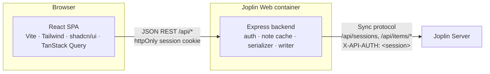

# Architecture

Joplin Server is a **sync target**: it stores raw items in Joplin's serialized text format and offers no consumer CRUD API for notes. Joplin Web puts an Express backend between the browser and Joplin Server that translates between a small JSON REST API and the sync protocol.



In production the backend also serves the compiled client (`client/dist`) on the same port. Content-hashed files under `/assets/` are sent with `Cache-Control: public, max-age=31536000, immutable`; `index.html` (also the SPA fallback) and other files with `no-cache`, so a new release is picked up on the next load.

## Backend modules (`server/src`)

| Module | Responsibility |
| :--- | :--- |
| `services/joplin-api.ts` | HTTP client for Joplin Server; maps errors to `JoplinAuthError` / `JoplinNotFoundError` / `JoplinConnectionError`. |
| `services/serializer.ts` | `deserialize` / `serialize` Joplin's text format, `stripMarkdown` / `stripHtml` (via `notePreview`, by `markup_language`) for list previews. |
| `services/note-cache.ts` | Per-session in-memory cache of all items, refreshed after `CACHE_TTL_MS`; only items whose `updated_time` changed are re-fetched. Builds the notebook tree, note lists, tag counts and search (all without conflict copies, see *Conflict copies*) and the conflicts list; every item in them carries `encrypted` (see *Encrypted items*). A session's cache is freed on logout, when Joplin Server rejects the session, and after 2 hours without use (expired or abandoned sessions never log out). |
| `services/search-query.ts` | Parses the search syntax (words, phrases, negation, `tag:`/`notebook:`/`type:`/`iscompleted:` filters) for `note-cache`'s search; see *Search syntax*. |
| `services/note-writer.ts` | All writes: create/update/trash/restore/purge for notes, notebooks, tags, note-tag links and resources; conflict detection; `getWriteState` (the E2EE guard as a yes/no answer for the client). |
| `services/item-defaults.ts` | Property sets Joplin desktop writes for new notes, notebooks, tags, note-tag links and resources; used by the writer on create. |
| `app.ts` | `createApp(config)`: helmet/CSP, CORS, rate limits, origin check, routers, static client. `index.ts` only starts it. |
| `middleware/auth.ts` | Accepts the session as `Authorization: Bearer` / `X-API-AUTH` (API clients) or the httpOnly `joplin_web_session` cookie (browser); never in the query string, which would leak into logs and referrers. Validates it against Joplin Server and caches the result for `AUTH_CACHE_TTL_MS`; logged-out sessions are cached as invalid. |
| `middleware/origin-check.ts` | CSRF protection for POST/PUT/DELETE: the `Origin` header must match the request's `Host`/`X-Forwarded-Host`, `PUBLIC_URL` or `CORS_ORIGIN`. Requests without `Origin` (non-browser clients) pass only when they don't use the cookie. |
| `middleware/request-logger.ts` | morgan access log with sensitive query parameters (`auth`, `token`, `password`, …) redacted. |
| `middleware/error-handler.ts` | Maps errors to JSON responses; 5xx responses carry a generic message only (details are logged). |
| `config.ts` | Reads the environment (`JOPLIN_SERVER_URL`, `PUBLIC_URL`, `TRUST_PROXY`, `ALLOW_REMOTE_IMAGES`, `COOKIE_SECURE`, `RATE_LIMIT_MAX`, …); exits at startup on invalid values or when `JOPLIN_SERVER_URL` is missing. There is no default server. |
| `routes/*.ts` | Thin Express 5 routers per resource. Handlers are plain `async` functions: Express 5 forwards rejected promises to the error handler, so they have no try/catch. |

## Joplin sync protocol

### Endpoints used

| Call | Purpose |
| :--- | :--- |
| `GET /api/ping` | Health check |
| `POST /api/sessions` `{ email, password }` | Login, returns `{ id, user_id }` |
| `POST /logout` (`X-API-AUTH` + `sessionId` cookie) | Ends the session (Joplin Server's web logout; there is no API route for it). Its CSRF check skips `/logout`. Success is a redirect to `<baseUrl>/login`; anything else is treated as failure. |
| `GET /api/items/root:/:/children?cursor=` | Paginated listing of all items (`{ items, has_more, cursor }`) |
| `GET /api/items/root:/<id>.md:/content` | Raw item text |
| `GET /api/items/root:/.resource/<id>:/content` | Attachment binary |
| `GET /api/items/root:/info.json:/content` | Sync target info (E2EE state), checked before writes (see Write rules); 404 means none yet |
| `PUT /api/items/root:/<name>:/content` | Create or replace an item (multipart, field `file`) |
| `DELETE /api/items/root:/<name>:` | Delete an item |

### Item types (`type_`)

`1` Note · `2` Folder (notebook) · `4` Resource (attachment metadata) · `5` Tag · `6` Note–tag link. Other types (settings, revisions, …) are ignored. Every item is stored as `<32-hex-id>.md`; attachment binaries live at `.resource/<id>`.

### Serialized format

```text
Title line

Markdown body (notes only)…

id: b1c2d3e4f5a6b7c8d9e0f1a2b3c4d5e6
parent_id: a1b2c3d4e5f6a7b8c9d0e1f2a3b4c5d6
created_time: 2026-10-17T16:00:00.000Z
updated_time: 2026-10-17T16:05:00.000Z
is_todo: 0
type_: 1
```

- Properties are parsed **bottom-up** until the first blank line; line 1 above it is the title, the rest (after one blank line) is the body. Property order is kept on a round trip.
- Like Joplin's `BaseItem.unserialize`, content is split on `\n` only: a `\r` in the body (CRLF line endings) is part of the text and is written back unchanged. Only property lines are trimmed.
- Newlines in property values are escaped as `\n`, with Joplin's exact escape/unescape chain. That format cannot tell a backslash followed by a real newline from a literal `\n`; Joplin has the same limitation (#55), and matching it keeps values read identically by all clients.
- Notes reference attachments as `` and other notes as `[text](:/<noteId>)`; the client resolves these to `/api/resources/:id` and in-app links.

### Write rules

- Serialization mirrors Joplin's `BaseItem.serialize`. The title line is always written (even when empty), so a body is never read back as a title.
- Updates start from the item's **original property set** and change only the edited fields plus `updated_time` / `user_updated_time`. Unknown properties round-trip untouched.
- New items get the full default property set Joplin desktop writes (32-hex id, `markup_language: 1`, `source: joplin-web`, …).
- Ids in paths are validated against `^[0-9a-f]{32}$` before any request is made.
- **E2EE:** Joplin Web cannot encrypt. Before writing it checks `info.json`; if `e2ee.value` is true (or the file is unreadable) the write is refused with `422`, so nothing is uploaded in plaintext to an encrypted account. A successful check is reused per session for up to 60 s while the cache listing shows the same `info.json` `updated_time`, so autosaves do not re-read it; a refresh that sees a changed `info.json` forces a new check. E2EE turned on by another client therefore blocks writes after at most the shorter of the cache TTL and 60 s. Without an `info.json` (sync targets older than sync version 3), master key items (`type_: 9`), any `encryption_applied: 1` item, or an item the cache failed to read (it could be a master key) make the account read-only too. Encrypted items (`encryption_applied: 1`) are refused as well, as targets too: no notes or sub-notebooks in an encrypted notebook, no links to an encrypted tag. `GET /api/account/write-state` runs the same check (`noteWriter.getWriteState`) and answers `{ writable: false, reason }` with the exact message a write would be refused with, so the client turns read-only up front instead of failing every save; other failures (expired session, Joplin Server down) are errors as usual.
- **Encrypted items** keep only `id`, `parent_id`, `note_id`, `tag_id`, `updated_time`, `deleted_time` and `type_` in clear (Joplin's `BaseItem.serializeForSync`); title, body and everything else are in `encryption_cipher_text`. The cache never tries to read them: lists, details, the tree, the trash and tags mark them `encrypted: true`; notebooks and tags get the display titles "Encrypted notebook" / "Encrypted tag", notes keep an empty title and body (the client shows "Encrypted note"). Search only looks at titles and bodies, so it never matches cipher text.
- Target notebooks (create, move) are re-read from Joplin Server, so one trashed or deleted elsewhere is refused even while the cache still shows it. A note in the trash (or in a trashed notebook) cannot be tagged.
- **Conflicts:** writes carry the `baseUpdatedTime` the editor started from; the writer re-reads the item and answers `409` with the current version if it changed. The UI offers *Overwrite* (`force: true`) or *Load theirs*.
- **Trash:** deleting sets `deleted_time`. Trashing a notebook also trashes its sub-notebooks and their notes; restoring a note restores its trashed parent notebooks. Restoring a notebook (only one in the trash, else `409`) brings back the sub-notebooks and notes trashed *together* with it, plus any trashed parent notebooks; items trashed on their own earlier stay in the trash. "Together" means a `deleted_time` at most 60 s before the notebook's (`services/trash.ts`): Joplin Web stamps a cascade with one time, but Joplin desktop trashes children first, each with its own `Date.now()`. (Joplin desktop's own restore brings back all notes of a folder and moves items with a trashed parent to the top level instead.) The trash list counts the same way, so its numbers match what Restore brings back. Cascades read every affected item first (up to 10 reads in parallel, level by level) and write only if all pass (no encrypted item), so they never stop halfway on such an item.
- **Conflict copies** (`is_conflict: 1`): when Joplin desktop/mobile hits a sync conflict it keeps a copy of the note with `is_conflict: 1` and `conflict_original_id` in the original notebook, and shows it only in its virtual *Conflicts* folder. Joplin Web mirrors `Note.previews` / `Folder.noteCountsByFolderId`: conflict copies are left out of notebook and tag lists, "All notes", note counts, tag counts and search, and listed only with `GET /api/notes?is_conflict=true` (`is_conflict = 1 AND deleted_time = 0`, wherever their notebook is). Like `Folder.batchDelete`, trashing or purging a notebook leaves its untrashed conflict copies alone (they stay in *Conflicts*, a purged notebook's copies have no notebook any more); a copy in a trashed notebook is therefore not in the trash and can only be purged after trashing it itself. Trashing a copy sets its own `deleted_time` (it keeps `is_conflict`, so restoring brings it back to *Conflicts* without touching its notebook). Editing keeps the flag; moving it to a notebook (its own one too) clears `is_conflict` and `conflict_original_id`, as `Note.moveToFolder` does, which turns it into a regular note.
- **Permanent deletion** only applies to items in the trash, like Joplin's *Delete permanently*. A note is re-read and must be a note (not a notebook, tag or resource), not encrypted, and trashed itself or inside a trashed notebook. Purging a notebook refreshes the cache and re-reads each item, so notes another client moved out are kept. Note–tag links are removed too.
- After each write the cache is updated immediately, so lists reflect the change without waiting for the TTL. Written items get a negative "local write" timestamp, so the next refresh re-reads them and removes them if another client deleted them meanwhile. A refresh that started before a local write or delete does not apply the content it fetched for that item, so a slow refresh cannot put an older version back into the cache (which would cause a false `409` on the next autosave).
- **Joplin Server errors:** a `401`, or a `403` for a session that Joplin Server no longer accepts (re-checked), answers `401` and marks the session invalid, so the client signs in again. A `403` for a valid session stays `403`. `5xx` errors answer with a generic message, never the upstream text.

## REST API (backend → browser)

All routes except `/api/health` and `/api/auth/login` require a session.

| Method | Path | Description |
| :--- | :--- | :--- |
| `GET` | `/api/health` | Health check: `{ status, version, commit }` (build metadata only, no configuration) |
| `POST` | `/api/auth/login` | `{ email, password }` → `{ userId }` and the session cookie: `joplin_web_session` (`HttpOnly; SameSite=Strict; Path=/api`) over HTTP, `__Host-joplin_web_session` (`Secure; Path=/`) over HTTPS. Requests carrying more than one session cookie get 401. Only requests without an `Origin` header (non-browser API clients) also get `sessionId` in the body. |
| `POST` | `/api/auth/logout` | Ends the session on Joplin Server, drops cached session state and the note cache, clears the cookie |
| `GET` | `/api/auth/check` | Validates the session → `{ valid: true, serverHost }` (Joplin Server host and port, for display; visible to every signed-in user) |
| `GET` | `/api/account/write-state` | `{ writable: true }`, or `{ writable: false, reason }` when the account is read-only (E2EE); same check as every write |
| `GET` | `/api/notebooks` | Nested notebook tree with note counts |
| `GET` | `/api/notebooks/trash` | Trashed notebooks (top of each trashed subtree) with note and sub-notebook counts |
| `POST` | `/api/notebooks/refresh` | Forces a cache re-sync |
| `POST` | `/api/notebooks` | Create notebook `{ title, parentId }` |
| `PUT` | `/api/notebooks/:id` | Rename / move notebook |
| `DELETE` | `/api/notebooks/:id` | Trash notebook; `?permanent=true` deletes a trashed one |
| `POST` | `/api/notebooks/:id/restore` | Restore a trashed notebook with its contents |
| `GET` | `/api/notes` | List; filters `notebook_id`, `tag_id`, `is_trash`; `is_conflict=true` lists only conflict copies (other filters ignored). Items carry `isConflict`. |
| `GET` | `/api/notes/:id` | Note with body, list `preview`, notebook, tags and `markupLanguage` (1 = Markdown, 2 = HTML; the write routes below return the same shape); `isConflict` / `conflictOriginalId` for conflict copies |
| `POST` | `/api/notes` | Create `{ title, body, parentId, isTodo }` |
| `PUT` | `/api/notes/:id` | Update `{ title, body, parentId, todoCompleted, baseUpdatedTime, force }` |
| `DELETE` | `/api/notes/:id` | Trash; `?permanent=true` deletes |
| `POST` | `/api/notes/:id/restore` | Restore from trash |
| `POST` | `/api/notes/:id/tags` | Add tag by title `{ title }` |
| `DELETE` | `/api/notes/:id/tags/:tagId` | Remove tag from note |
| `GET` | `/api/tags` | Tags with note counts |
| `PUT` | `/api/tags/:id` | Rename tag |
| `DELETE` | `/api/tags/:id` | Delete tag and its links |
| `GET` | `/api/search?q=` | Search over active notes (see *Search syntax*); each result has `matches: { inTitle, inBody, snippet, terms }` |
| `POST` | `/api/resources` | Upload attachment (raw body, `X-File-Name`, `X-File-Type`) |
| `GET` | `/api/resources/:id` | Attachment binary (see *Serving attachments*) |
| `DELETE` | `/api/resources/:id` | Delete attachment |

### Search syntax

`GET /api/search` uses a subset of Joplin desktop's syntax, parsed by `services/search-query.ts`. Everything is case-insensitive; trashed notes (and notes in trashed notebooks) are never returned.

| Syntax | Meaning |
| :--- | :--- |
| `shopping list` | Every word must appear in the title or the body, in any order (substring match). |
| `"shopping list"` | Exact phrase. An unclosed quote runs to the end of the query. |
| `-word`, `-"some phrase"` | The note must not contain it. |
| `tag:name`, `tag:"two words"` | The note has a tag with this title. Several `tag:` filters must all match; `-tag:` excludes. |
| `notebook:name` | The note is in a notebook with this title **or any of its sub-notebooks** (like Joplin desktop). Several `notebook:` filters match any of them; `-notebook:` excludes the notebook and its sub-notebooks. |
| `type:todo`, `type:note` | Only to-dos / only plain notes. |
| `iscompleted:1`, `iscompleted:0` | Completed / open to-dos (implies to-dos). |

Filter values may be quoted; tag and notebook names must match the whole title, with `*` as a wildcard (`tag:proj*`). Unknown filters and invalid values (`foo:bar`, `type:x`) are searched as plain words. A query of only filters is valid and lists all notes that pass them. Results are sorted by how many terms match in the title (×100) and body (×10), then by `updatedTime`. `matches.terms` lists the lower-cased positive words/phrases so the client highlights them; `snippet` is cut around the first term found in the body (empty for filter-only queries, where the client shows the preview).

### Security headers

- helmet's defaults apply to every response, with `img-src 'self' data: blob:` (attachments are shown through `blob:`/`data:` URLs; `https:` is added with `ALLOW_REMOTE_IMAGES`) and `Referrer-Policy: no-referrer`. `upgrade-insecure-requests` is only sent when `PUBLIC_URL` is `https://`, so plain-HTTP LAN setups keep working. The Vite dev server sends the same `img-src`.
- `script-src` must stay `'self'` and must **never** allow `'unsafe-inline'`: attachment `blob:` URLs opened directly run in the app's origin, and the CSP is what keeps script in them from running.
- **Serving attachments:** attachments are user content served from our origin, so `GET /api/resources/:id` always sends `X-Content-Type-Options: nosniff` and `Content-Security-Policy: default-src 'none'; …; sandbox`. Only raster images, PDF, plain text, audio and video are sent `inline`. SVG keeps `image/svg+xml` (so `` can show it) but is sent as `attachment`; every other type (HTML, XML, JavaScript, unknown or malformed types) becomes `application/octet-stream` + `attachment`. File names go into `Content-Disposition` as an ASCII fallback plus RFC 5987 `filename*`.
- The client loads attachments with `fetch` (session cookie) and renders them from `blob:` URLs. SVG is rendered from a `data:` URL instead (browsers don't open `data:` URLs as documents), and downloads use `application/octet-stream` blobs, so an SVG never becomes a document in the app's origin.

### Sessions

- The browser never sees the token: it lives in the httpOnly cookie. On startup the client calls `/api/auth/check`; only the email address (for display) is kept in `localStorage`.
- Rate limits per client address and 15 minutes: `RATE_LIMIT_MAX` requests on `/api/` (default 1000), 30 login attempts. A 429 carries `Retry-After`.
- `TRUST_PROXY` sets Express' `trust proxy`, so `req.ip` (rate limits, logs) and `req.secure` (cookie `Secure` flag) reflect the client behind a reverse proxy. Off by default, so a directly exposed instance can't be fooled by a forged `X-Forwarded-For`.
- Logout (client): unmounts the notes UI so open editors flush their changes, waits for pending writes, calls `/api/auth/logout`, then clears the TanStack Query cache and revokes cached attachment URLs. Login also clears the query cache.

## Frontend (`client/src`)

- `lib/api.ts`: fetch wrapper (`credentials: "include"`, `referrerPolicy: "same-origin"` so the CSRF check gets a real `Origin`). Every request outcome feeds `lib/connection.ts` (pending writes, last update, last network/5xx error, session expiry). A 401 on an authenticated request marks the session expired and the "Session expired" dialog sends the user to `/login`, which returns to the same page; login and session checks show the server's error message.
- `lib/connection.ts` + `hooks/use-connection.ts`: the sidebar connection status (`deriveConnectionStatus`), manual refresh (`POST /api/notebooks/refresh`, then invalidate all queries) and the refresh on tab focus / visibility / `online`, throttled to 30 s. Both skip `["note", id]` queries of notes whose editor has unsaved edits (`setNoteUnsaved`).
- `lib/drafts.ts`: unsaved editor text in `localStorage` (`joplin-draft:<noteId>`, with the `baseUpdatedTime` it was based on and its owner, email + Joplin Server host). Written on every edit; removed after a successful save, on logout, on *Sign out and discard*, after 7 days, and on login when the owner differs. The viewer offers to restore a draft that differs from the server text and blocks editing until the user restores or discards it; a restored draft is saved with its original base, so conflict detection still applies.
- `hooks/use-write-state.ts`: `useWriteState()` reads `/api/account/write-state` (refetched with every other query on refresh; counts as writable while unknown, the server still refuses). `NotesPage` passes `readOnly` down: the layout shows a "Read-only" banner with the server's reason, and the sidebar, note list, viewer and trash hide editing, creating, to-do toggles, tags, trash actions and (with the editor) uploads. Encrypted notes, notebooks and tags (`encrypted: true`) are shown with a lock and get no actions even on a writable account. Any write refused with `422` (mutations via the `MutationCache`, editor saves via `use-note-saver`) invalidates the write state; the editor shows the server's message inline ("Not saved. …") and does not retry a `422`.
- `hooks/use-*.ts`: TanStack Query hooks; `use-mutations.ts` invalidates note/notebook/tag queries after writes. `use-note-saver.ts` is the write path for note text shared by the editor and the read-mode checkbox toggle: it sends `baseUpdatedTime`, adopts the returned one, updates the `["note", id]` cache and the lists, and exposes the save in flight so callers can run saves one at a time. The checkbox toggle takes its base from the cached note it edits, so it always builds on the latest save, including one made in the editor. A title/body save does not refetch any list (autosave would otherwise cost four requests every few seconds against the rate limit): `updateNoteInLists` patches the note's entries in the cached note lists and search results with the returned title, `preview` and `updatedTime`, keeps note lists newest first like the server, and only marks searches stale (matches and snippets may differ; they reload the next time they are shown). Notebook and tag counts can't change through such a save. A save that moves the note or changes its to-do state refetches all lists.
- `pages/NotesPage.tsx`: three-pane layout (sidebar, note list, note view/editor). The URL is the only source of truth for the selected list and note, so browser Back/Forward work; handlers just navigate. Routes: `/notes` and `/notes/:id` (optionally `?tag=:tagId`), `/notebooks/:id` and `/notebooks/:notebookId/notes/:id`, `/conflicts` and `/conflicts/:id`, `/trash` and `/trash/:id`. A plain `/notes/:id` opened directly is replaced by its notebook URL (for a conflict copy `/conflicts/:id`) once the note has loaded. The sidebar shows *Conflicts* (from `useConflictNotes`) only while there are conflict copies or the list is open; the viewer marks a copy, links to its original and keeps its tags read-only.
- `components/notes/NoteEditor.tsx`: lazy-loaded chunk (`React.lazy` in `NoteViewer`, prefetched once a note is shown; if it fails to load, an error boundary offers Retry with a fresh import, then a page reload, and Back to reading), CodeMirror editor, Edit/Split/Preview, debounced autosave, `Ctrl+S`, conflict dialog, attachment upload, retry with backoff for saves that failed on a network/5xx error or were rate limited (429, `isTemporaryFailure`; `lib/retry.ts`: at most 6 attempts, never sooner than the server's `Retry-After` (capped at 15 minutes), immediately on `online`, disposed when the editor closes). A refresh that brings a newer version of the open note replaces the text when there are no local edits, and shows a Load latest / Keep mine banner otherwise. Saves run one at a time: a save requested while another is in flight (autosave, Done, the flush when the editor closes) waits for it and then sends the remaining changes with the `baseUpdatedTime` it returned.
- `components/common/MarkdownRenderer.tsx` + `lib/tasks.ts`: task checkboxes carry the source line/column of their list item as parsed by remark-gfm, and `setTaskChecked` flips the `[ ]` at exactly that position (so code blocks, HTML comments and empty `- [ ]` items are never touched). The `:/id` link rewrite keeps line breaks so positions still match the note body.
- HTML notes (`markupLanguage: 2`, e.g. from the Web Clipper) go through `MarkdownRenderer` with `html`: a remark plugin replaces the parsed tree with one raw HTML node, so no Markdown rules apply (blank lines don't end the HTML, no indented code blocks, no `*emphasis*`), while rehype-raw, the same sanitize schema, the `:/id` rewrite of `` / `<a href>` and the components stay the same. The editor edits their raw HTML (as Joplin desktop does) with a hint, inserts uploads as `` / `<a>`, and saves never touch `markup_language`.
- `:/id#heading` links (Markdown and HTML) open the note at `/notes/<id>#<slug>`; `MarkdownRenderer` then scrolls once to the heading whose Joplin-style slug matches (`lib/heading-slug.ts`, with `-1`, `-2`… for repeated headings). Ids must be 32 hex characters; the fragment can't contain quotes, whitespace, `<>` or parentheses.
- `components/ui/`: generated shadcn/ui primitives. Avoid hand-editing them.

## Mock Joplin Server (`server/demo`)

`mock-joplin-server.ts` implements the endpoints above in memory; `seed.ts` builds sample notebooks, notes, tags and an image with stable ids (`demoId(key)`). `buildEncryptedDemoItems()` is the same account with E2EE on (`info.json` `e2ee: true`, plus an encrypted notebook, notes, tag and note-tag link written the way Joplin's `serializeForSync` does); `DEMO_E2EE=1 npm run demo` starts the demo with it. It backs `npm run demo`, the API tests and the README screenshots. When Joplin Web starts using a new Joplin Server endpoint, add it to the mock too.
