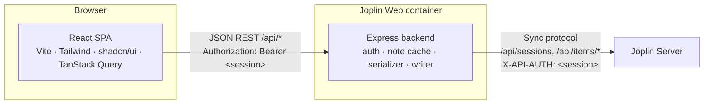

# Architecture

Joplin Server is a **sync target**: it stores raw items in Joplin's serialized text format and offers no consumer CRUD API for notes. Joplin Web puts an Express backend between the browser and Joplin Server that translates between a small JSON REST API and the sync protocol.



In production the backend also serves the compiled client (`client/dist`) on the same port.

## Backend modules (`server/src`)

| Module | Responsibility |
| :--- | :--- |
| `services/joplin-api.ts` | HTTP client for Joplin Server; maps errors to `JoplinAuthError` / `JoplinNotFoundError` / `JoplinConnectionError`. |
| `services/serializer.ts` | `deserialize` / `serialize` Joplin's text format, `stripMarkdown` for list previews. |
| `services/note-cache.ts` | Per-session in-memory cache of all items, refreshed after `CACHE_TTL_MS`; only items whose `updated_time` changed are re-fetched. Builds the notebook tree, note lists, tag counts and search. |
| `services/note-writer.ts` | All writes: create/update/trash/restore/purge for notes, notebooks, tags, note-tag links and resources; conflict detection. |
| `middleware/auth.ts` | Accepts the session as `Authorization: Bearer` or `X-API-AUTH` (never in the query string, which would leak into logs and referrers); validates it against Joplin Server and caches the result for `AUTH_CACHE_TTL_MS`. |
| `middleware/request-logger.ts` | morgan access log with sensitive query parameters (`auth`, `token`, `password`, …) redacted. |
| `middleware/error-handler.ts` | Maps errors to JSON responses; 5xx responses carry a generic message only (details are logged). |
| `config.ts` | Reads the environment; exits at startup when `JOPLIN_SERVER_URL` is missing or not an http(s) URL. There is no default server. |
| `routes/*.ts` | Thin Express routers per resource. |

## Joplin sync protocol

### Endpoints used

| Call | Purpose |
| :--- | :--- |
| `GET /api/ping` | Health check |
| `POST /api/sessions` `{ email, password }` | Login, returns `{ id, user_id }` |
| `GET /api/items/root:/:/children?cursor=` | Paginated listing of all items (`{ items, has_more, cursor }`) |
| `GET /api/items/root:/<id>.md:/content` | Raw item text |
| `GET /api/items/root:/.resource/<id>:/content` | Attachment binary |
| `PUT /api/items/root:/<name>:/content` | Create or replace an item (multipart, field `file`) |
| `DELETE /api/items/root:/<name>:` | Delete an item |

### Item types (`type_`)

`1` Note · `2` Folder (notebook) · `4` Resource (attachment metadata) · `5` Tag · `6` Note–tag link. Other types (settings, revisions, …) are ignored. Every item is stored as `<32-hex-id>.md`; attachment binaries live at `.resource/<id>`.

### Serialized format

```text
Title line

Markdown body (notes only)…

id: b1c2d3e4f5a6b7c8d9e0f1a2b3c4d5e6
parent_id: a1b2c3d4e5f6a7b8c9d0e1f2a3b4c5d6
created_time: 2026-10-17T16:00:00.000Z
updated_time: 2026-10-17T16:05:00.000Z
is_todo: 0
type_: 1
```

- Properties are parsed **bottom-up** until the first blank line; line 1 above it is the title, the rest (after one blank line) is the body.
- Newlines in property values are escaped as `\n`.
- Notes reference attachments as `` and other notes as `[text](:/<noteId>)`; the client resolves these to `/api/resources/:id` and in-app links.

### Write rules

- Serialization mirrors Joplin's `BaseItem.serialize`. The title line is always written (even when empty), so a body is never read back as a title.
- Updates start from the item's **original property set** and change only the edited fields plus `updated_time` / `user_updated_time`. Unknown properties round-trip untouched.
- New items get the full default property set Joplin desktop writes (32-hex id, `markup_language: 1`, `source: joplin-web`, …).
- Ids in paths are validated against `^[0-9a-f]{32}$` before any request is made.
- Encrypted items (`encryption_applied: 1`) are rejected for writing.
- **Conflicts:** writes carry the `baseUpdatedTime` the editor started from; the writer re-reads the item and answers `409` with the current version if it changed. The UI offers *Overwrite* (`force: true`) or *Load theirs*.
- **Trash:** deleting sets `deleted_time`. Trashing a notebook also trashes its sub-notebooks and their notes; restoring a note restores its trashed parent notebooks. Permanent deletion also removes note–tag links.
- After each write the cache is updated immediately, so lists reflect the change without waiting for the TTL.

## REST API (backend → browser)

All routes except `/api/health` and `/api/auth/login` require a session.

| Method | Path | Description |
| :--- | :--- | :--- |
| `GET` | `/api/health` | Health check |
| `POST` | `/api/auth/login` | `{ email, password }` → `{ sessionId, userId }` |
| `POST` | `/api/auth/logout` | Drops cached session state |
| `GET` | `/api/auth/check` | Validates the session |
| `GET` | `/api/notebooks` | Nested notebook tree with note counts |
| `POST` | `/api/notebooks/refresh` | Forces a cache re-sync |
| `POST` | `/api/notebooks` | Create notebook `{ title, parentId }` |
| `PUT` | `/api/notebooks/:id` | Rename / move notebook |
| `DELETE` | `/api/notebooks/:id` | Trash notebook; `?permanent=true` deletes a trashed one |
| `GET` | `/api/notes` | List; filters `notebook_id`, `tag_id`, `is_trash` |
| `GET` | `/api/notes/:id` | Note with body, notebook and tags |
| `POST` | `/api/notes` | Create `{ title, body, parentId, isTodo }` |
| `PUT` | `/api/notes/:id` | Update `{ title, body, parentId, todoCompleted, baseUpdatedTime, force }` |
| `DELETE` | `/api/notes/:id` | Trash; `?permanent=true` deletes |
| `POST` | `/api/notes/:id/restore` | Restore from trash |
| `POST` | `/api/notes/:id/tags` | Add tag by title `{ title }` |
| `DELETE` | `/api/notes/:id/tags/:tagId` | Remove tag from note |
| `GET` | `/api/tags` | Tags with note counts |
| `PUT` | `/api/tags/:id` | Rename tag |
| `DELETE` | `/api/tags/:id` | Delete tag and its links |
| `GET` | `/api/search?q=` | Full-text search over titles and bodies |
| `POST` | `/api/resources` | Upload attachment (raw body, `X-File-Name`, `X-File-Type`) |
| `GET` | `/api/resources/:id` | Attachment binary (see *Serving attachments*) |
| `DELETE` | `/api/resources/:id` | Delete attachment |

### Security headers

- helmet's defaults apply to every response, with `img-src 'self' data: blob:` (attachments are shown through `blob:` URLs) and `Referrer-Policy: no-referrer`.
- **Serving attachments:** attachments are user content served from our origin, so `GET /api/resources/:id` always sends `X-Content-Type-Options: nosniff` and `Content-Security-Policy: default-src 'none'; …; sandbox`. Only raster images, PDF, plain text, audio and video are sent `inline`. SVG keeps `image/svg+xml` (so `` can show it) but is sent as `attachment`; every other type (HTML, XML, JavaScript, unknown or malformed types) becomes `application/octet-stream` + `attachment`. File names go into `Content-Disposition` as an ASCII fallback plus RFC 5987 `filename*`.
- The client loads attachments with `fetch` + session header and renders them from `blob:` URLs; it never puts the session into a URL.

## Frontend (`client/src`)

- `lib/api.ts`: fetch wrapper; stores the session in `localStorage`.
- `hooks/use-*.ts`: TanStack Query hooks; `use-mutations.ts` invalidates note/notebook/tag queries after writes.
- `pages/NotesPage.tsx`: three-pane layout (sidebar, note list, note view/editor). The URL is the only source of truth for the selected list and note, so browser Back/Forward work; handlers just navigate. Routes: `/notes` and `/notes/:id` (optionally `?tag=:tagId`), `/notebooks/:id` and `/notebooks/:notebookId/notes/:id`, `/trash` and `/trash/:id`. A plain `/notes/:id` opened directly is replaced by its notebook URL once the note has loaded.
- `components/notes/NoteEditor.tsx`: CodeMirror editor, Edit/Split/Preview, debounced autosave, `Ctrl+S`, conflict dialog, attachment upload. Saves run one at a time: a save requested while another is in flight (autosave, Done, the flush when the editor closes) waits for it and then sends the remaining changes with the `baseUpdatedTime` it returned.
- `components/common/MarkdownRenderer.tsx` + `lib/tasks.ts`: task checkboxes carry the source line/column of their list item as parsed by remark-gfm, and `setTaskChecked` flips the `[ ]` at exactly that position (so code blocks, HTML comments and empty `- [ ]` items are never touched). The `:/id` link rewrite keeps line breaks so positions still match the note body.
- `components/ui/`: generated shadcn/ui primitives. Avoid hand-editing them.

## Mock Joplin Server (`server/demo`)

`mock-joplin-server.ts` implements the endpoints above in memory; `seed.ts` builds sample notebooks, notes, tags and an image with stable ids (`demoId(key)`). It backs `npm run demo`, the API tests and the README screenshots. When Joplin Web starts using a new Joplin Server endpoint, add it to the mock too.
